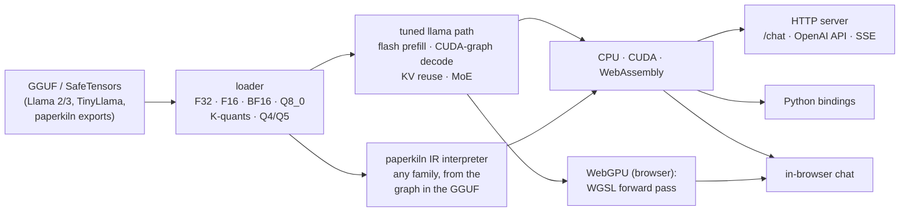
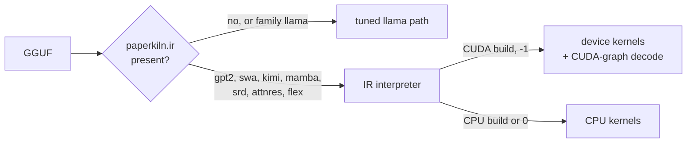

# ember.cpp

**A from-scratch C++ inference engine for Llama-family models and for every architecture
[paperkiln](https://github.com/JohnnyTeutonic/paperkiln) trains, on CPU, CUDA, WebAssembly
and, in the browser, the visitor's own GPU.**

*Formerly `tinyllama.cpp` (renamed 2026-08-01; GitHub redirects the old URL). The binaries
keep their old names, `tinyllama` and `tinyllama_server`.*

**[▶ Chat with a model trained from scratch, running in your browser](https://huggingface.co/spaces/johnnyteutonic/ember-chat)**:
a 14.6M-parameter paperkiln model, served by ember.cpp compiled to WebAssembly. Nothing you
type leaves the page.



## What it runs

| Model family | How | CPU | CUDA | WASM | WebGPU |
|---|---|:---:|:---:|:---:|:---:|
| Llama 2/3, TinyLlama (GGUF, SafeTensors) | tuned path | ✅ | ✅ | ✅ | ✅ (f32, Q8_0) |
| paperkiln llama chat models | tuned path | ✅ | ✅ | ✅ | ✅ |
| Mixture of experts (llama.cpp expert layout) | tuned path, routed experts | ✅ | ✅ | ✅ | ✅ |
| GPT-2 (layernorm, GELU, learned positions) | IR interpreter | ✅ | ✅ | ✅ | |
| Sliding-window attention with sinks | IR interpreter | ✅ | ✅ | ✅ | |
| Kimi linear attention (recurrent state) | IR interpreter | ✅ | ✅ | ✅ | |
| Mamba-style state-space scan | IR interpreter | ✅ | ✅ | ✅ | |
| SRD, AttnRes, flex (highway, plain residual) | IR interpreter | ✅ | ✅ | ✅ | |

Every paperkiln family is gated the same way: **greedy replies identical to paperkiln's own
sampler on 40 frozen prompts**, on each backend, including a trained 70M mixture-of-experts
model. The receipts are in [`experiments/`](experiments/).

**Highlights**

- **Fast where it matters.** CUDA prefill is 7.5x to 188x faster than the original path, up to
  4,096 tokens ([docs/TTFT.md](docs/TTFT.md)). A whole decode step is captured as one CUDA
  graph: 2.7 ms/token and a first streamed word in 16-20 ms on a laptop RTX 4060.
- **The visitor's GPU, in the browser.** The chat page runs the forward pass through WebGPU when
  the browser has it, and falls back to WebAssembly when it does not. On an Intel laptop GPU it
  answers in 166 ms per reply against 646 ms for WebAssembly, with replies identical to ember's
  CPU on all 40 prompts. Q8_0 weights stay quantised on the GPU.
- **Any paperkiln network, not just llama.** paperkiln writes the model's graph into the GGUF
  (`paperkiln.ir`). ember's interpreter runs it on the CPU or GPU, with a CUDA-graph decode of
  its own, and refuses at load any op it cannot run, naming it.
- **Quantised models.** Q8_0, K-quants, and Q4_0/Q4_1/Q5_0/Q5_1. The legacy formats are
  bit-identical to the reference dequantiser and can stay in their blocks for large models.
- **Serving features.** Server-sent-event streaming, an OpenAI-compatible API, KV prefix reuse
  across turns, a repetition penalty defined jointly with paperkiln, speculative decoding, and a
  hardened public mode.
- **From checkpoint to the public chat in one command.** `tools/release_chat.py` exports, gates,
  evaluates and builds the browser page, and publishes only when told to.
- **Proved, not assumed.** Parity tools in [`tools/`](tools/) compare ember with paperkiln token
  by token. Kernel tests check the attention, MoE and recurrent kernels against
  double-precision references.

## Quick start: build and chat

```bash
git clone https://github.com/JohnnyTeutonic/ember.cpp.git && cd ember.cpp
mkdir -p build && cd build && cmake .. -DCMAKE_BUILD_TYPE=Release && make -j && cd ..
./build/tinyllama_server path/to/model.gguf 8080 127.0.0.1 ./www -1   # -1: all layers on the GPU, 0: CPU
```

Open http://127.0.0.1:8080. You need CMake, a C++17 compiler and Boost; CUDA and OpenMP are
optional (details: [docs/USAGE.md](docs/USAGE.md)). Any GGUF from the
[paperkiln](https://github.com/JohnnyTeutonic/paperkiln) studio, or a Llama GGUF from Hugging
Face, works as `model.gguf`.

## Quick start: OpenAI-compatible API

```bash
curl http://127.0.0.1:8080/v1/chat/completions -H "Content-Type: application/json" \
  -d '{"messages": [{"role": "user", "content": "Hello!"}], "stream": false}'
```

`"stream": true` streams the reply token by token, and `GET /v1/models` lists the model. The
native `POST /chat` takes `{user_input, history, temperature, top_k, top_p, seed,
max_new_tokens, repeat_penalty, repeat_last_n}`, the same contract as paperkiln's `mtstudio chat`.

## Quick start: Python

```bash
pip install .            # CUDA: TINYLLAMA_CPP_BUILD_CUDA=1 pip install .
```

```python
import tinyllama_cpp
s = tinyllama_cpp.TinyLlamaSession(model_path="model.gguf", tokenizer_path="model.gguf",
                                   threads=4, n_gpu_layers=-1)
print(s.generate("What is AI?", steps=64))
```

## Quick start: in the browser

```bash
JSON_INC=<dir with nlohmann/json.hpp> bash deploy/wasm/build.sh out/    # needs Emscripten
bash tools/build_wasm_space.sh model.gguf out/ space/                   # the static chat page
```

`space/` is the whole site: open `index.html` from any static server.
- **Backends:** the page's worker uses WebGPU when the browser offers it
  (`deploy/wasm/web/webgpu/`) and otherwise WebAssembly SIMD; `?backend=wasm` forces the CPU.
- **Larger models:** `EMBER_WASM_MAX_MEMORY=4gb` raises the WebAssembly heap (a 70M f32 MoE
  needs it).
- **Threads:** `EMBER_WASM_THREADS=4` builds a pthreads variant for cross-origin-isolated pages.

[`tools/webgpu_parity/`](tools/webgpu_parity/) checks that the page gives the same replies on
both backends.

## Quick start: release a chat model

```bash
python3 tools/release_chat.py build --spec run/spec.json --ckpt run/model.safetensors --out rel/ \
  --mtstudio paperkiln/build/mtstudio --ember-cpu build/tinyllama_server --paperkiln paperkiln/
python3 tools/release_chat.py publish --out rel/ --env-file .env --confirm ember-chat   # only on the go-ahead
```

`build` runs five stages:
1. export;
2. the parity gate, f32 40/40 against mtstudio and Q8 on logits;
3. evals;
4. the WebAssembly build;
5. the Space folder.

Each stage leaves a receipt in `rel/release.json` and is skipped when rerun.

## Quick start: any paperkiln architecture

Export a model from paperkiln (`mtstudio run spec.json`; the GGUF carries its IR) and serve it
as above. ember picks the engine itself:



`EMBER_INTERPRETER=1` runs a llama model through the interpreter too, which is how the
interpreter is checked against the tuned path.

## Quick start: check a model against paperkiln

```bash
# ember on 8095, mtstudio chat on 8096, same model:
PARITY_EMBER_PORT=8095 PARITY_MTS_PORT=8096 PARITY_GGUF=model.gguf python3 tools/chat_parity.py 40
python3 tools/chat_ctx_parity.py 8095 8096 256      # long replies, long histories, over-long messages
python3 tools/quantize_gguf.py model.gguf model_q8.gguf --output-q8 --embed-q8   # Q8_0 (or --dequantize)
```

## Landing next

All of these are built or written; each is waiting on a model that is still training or on its gate run:
- **A llama.cpp-compatible vocabulary.** paperkiln's next base model uses the Llama 3 scheme
  (16,384 tokens), so llama.cpp, Ollama and LM Studio can tokenise it too. ember's chat mode
  already loads that form, with paperkiln's exact Llama 3 encoder vendored. Its 40/40 gate runs
  on the first model trained with it.
- **New chat models.** These are training on Colab: a 70M mixture-of-experts fine-tune, a d768
  L12 base and its fine-tune, and next a base trained on FineWeb-Edu plus conversational text.
  Each is released through `release_chat.py` with the WebGPU page.
- **The joint repetition-penalty gate** against paperkiln, at penalties 1.1 and 1.3.

## More

| | |
|---|---|
| Every option, endpoint, switch and the source layout | [docs/USAGE.md](docs/USAGE.md) |
| Time-to-first-token work and its method | [docs/TTFT.md](docs/TTFT.md) |
| Measured results, one folder per study | [experiments/](experiments/) |
| API reference (Doxygen) | [johnnyteutonic.github.io/ember.cpp](https://johnnyteutonic.github.io/ember.cpp/), built by the docs workflow |
| The training side | [paperkiln](https://github.com/JohnnyTeutonic/paperkiln) |

## License

MIT (declared in `pyproject.toml`).
