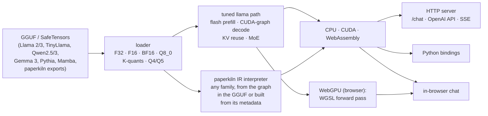
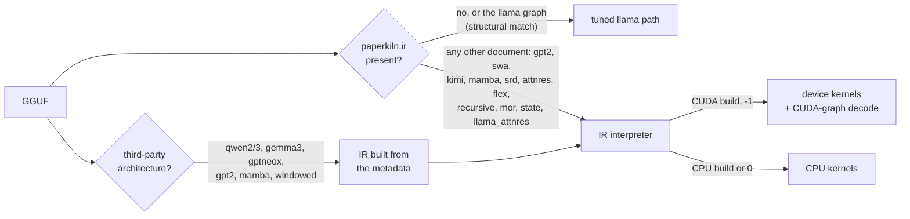

# ember.cpp

**A from-scratch C++ inference engine for Llama-family models, for third-party Qwen, Gemma 3,
Pythia and Mamba GGUFs, and for every architecture
[paperkiln](https://github.com/JohnnyTeutonic/paperkiln) trains, on CPU, CUDA, WebAssembly
and, in the browser, the visitor's own GPU.**

*Formerly `tinyllama.cpp` (renamed 2026-08-01; GitHub redirects the old URL). The binaries
keep their old names, `tinyllama` and `tinyllama_server`.*

**[▶ Chat with a model trained from scratch, running in your browser](https://huggingface.co/spaces/johnnyteutonic/ember-chat)**:
pk_sft_v1, paperkiln's 97.5M-parameter chat model of October 2026 (F16, 221 MB; published
30 October 2026), served by ember.cpp compiled to WebAssembly. Nothing you type leaves the page.
paperkiln's later chat models are not on the page; what they measurably do is in
[paperkiln's capability record](https://github.com/JohnnyTeutonic/paperkiln/blob/claude/readme-refresh/docs/CAPABILITY.md).



## What it runs

Each cell names the strongest evidence behind it, not only that the family runs:
**pk**, parity gates on paperkiln-trained models only (tiny test models or the programme's chat
models); **ck**, parity on an official released checkpoint; **syn**, synthetic or tiny random-weight
models only; **SwS**, a software WebGPU adapter (SwiftShader, on the CPU), which shows the WGSL is
correct and says nothing about a GPU; **page**, the chat page's WebAssembly replies only; **fb**, a
CUDA build serves it on its CPU path. GPU names say where the device gate ran.
[What each cell rests on](docs/CAPABILITY_EVIDENCE.md) gives the reference, tolerance, model and
receipt for every cell.

| Model family | How | CPU | CUDA | WASM | WebGPU |
|---|---|:---:|:---:|:---:|:---:|
| Llama 2/3, TinyLlama (GGUF, SafeTensors) | tuned path | ck (SmolLM2-135M) | pk | pk | pk (f32, Q8_0): Intel iGPU, L4 |
| paperkiln llama chat models | tuned path | pk | pk: RTX 4060, T4 | pk | pk: Intel iGPU, L4 |
| Mixture of experts (llama.cpp expert layout) | tuned path, routed experts | pk (70M) | pk (70M) | pk (70M) | pk: Intel iGPU, L4 |
| GPT-2 (layernorm, GELU, learned positions) | IR interpreter | pk | pk | pk | pk: L4, SwS |
| Sliding-window attention with sinks | IR interpreter | pk | pk | pk | pk: L4, SwS |
| Kimi linear attention (recurrent state) | IR interpreter | pk | pk | pk | pk: L4, SwS |
| Mamba-style state-space scan | IR interpreter | pk | pk | pk | pk: L4, SwS |
| SRD, AttnRes, flex (highway, plain residual) | IR interpreter | pk | pk | pk | pk: L4, SwS |
| Runtime-defined ops (`expr`: a paper's new activation or gate as a formula) | IR interpreter | pk | pk: RTX 4060, T4 | not gated | pk: L4, SwS |
| Tied-block recursion (`weight_index`: one stored block applied several times) | IR interpreter | pk | pk: T4 | page | pk: L4, SwS |
| Mixture-of-Recursions (`depth_route`: each token picks its depth) | IR interpreter | pk | pk: T4 | page | pk: L4, SwS |
| Per-turn state tokens with eviction (`turn_state`) | IR interpreter | pk | pk: T4 | pk | pk: L4, SwS (every row kept) |
| Attention residuals over depth (`llama_attnres`) | IR interpreter | pk | pk: T4 | pk | pk: L4, SwS |
| `llama_attnres` under tied-block recursion (`tensor_index`: each application reads its own pseudo-queries) | IR interpreter | pk | pk: T4 | pk | pk: SwS only |
| Recurrent ops the document defines (`recurrence`: a paper's new state-space model or linear attention as data) | IR interpreter | pk | fb | pk | pk: L4, SwS; ck (Mamba-130m rewrite): L4 |

The core paperkiln parity gates compare **greedy replies with paperkiln's own sampler on
40 frozen prompts**, including a trained 70M mixture-of-experts model; the other backends are
gated against ember's CPU interpreter (greedy 40/40, the top-1 at every position, logits within the
receipt's bound). The paperkiln families' models are small: most are d 32 to d 128 test models, so
these rows establish the operators, not quality or speed at scale. The WebGPU column of the IR rows
was first gated on SwiftShader ([`experiments/webgpu_ir_2026-10-26/`](experiments/webgpu_ir_2026-10-26/),
[`experiments/tensor_index_gate_2026-10-27/`](experiments/tensor_index_gate_2026-10-27/),
[`experiments/webgpu_recurrence_2026-10-27/`](experiments/webgpu_recurrence_2026-10-27/)), and every row
except `tensor_index` was then gated again in headless Chrome on an NVIDIA L4
([`experiments/webgpu_gpu_2026-10-27/`](experiments/webgpu_gpu_2026-10-27/README.md)). "page" means the
chat page's own WebAssembly build gave ember CPU's replies, 40/40, on the 40M Mixture-of-Recursions chat
model (8 applications over 4 stored layers); no logit-level WebAssembly gate exists for these two rows.

The recursion, Mixture-of-Recursions, state-token and attention-residual rows were built for
paperkiln's October 2026 tiny-chat programme (Carry-5 and Carry-12:
how small models carry a conversation over 5 and 12 turns; data mix, depth against width, recursion,
state tokens), whose models were trained on human-written text only. paperkiln's later chat models use
other data and are recorded elsewhere: research status is not kept in this README (see
[Research status](#research-status) below). ember serves the programme's models and checks
paperkiln's generation in its post jobs.

**Third-party GGUFs.** A llama.cpp GGUF with no `paperkiln.ir` gets its graph built from its
metadata at load (`build_ir_from_gguf`, a C++ port of keramos's `tools/gguf_ir.py`, node for
node) and runs on the interpreter:

| Family and checked checkpoint | What the graph has | CPU | CUDA | WASM | WebGPU |
|---|---|:---:|:---:|:---:|:---:|
| Qwen2.5 (0.5B-Instruct, f16) | q/k/v biases, NEOX RoPE, tied head, ChatML | ck | ck: RTX 4060, L4 | ck (10 prompts) | ck: L4 |
| Qwen3 (0.6B, Q8_0 read in place) | per-head q/k RMSNorm | ck | ck: L4 | ck (10 prompts) | ck: L4 |
| Gemma 3 (270m-it) | sliding window on 5 of every 6 layers, per-layer RoPE base, sandwich norms, GeGLU | ck | ck: RTX 4060, L4 | ck | ck: L4 |
| GPT-NeoX / Pythia (160m) | partial NEOX rotary, parallel residual, exact GELU | ck | ck: RTX 4060, L4 | ck | ck: L4, SwS |
| Mamba-1 (130m) | causal depthwise convolution and selective scan, recurrent state | ck | ck: RTX 4060 | ck | ck: L4, SwS |
| Mistral (sliding window) | the window as an attribute on the llama graph | syn | syn | syn | syn: L4, SwS |
| GPT-2 (124M) | fused qkv, LayerNorm, learned positions | ck | syn | syn | syn: L4, SwS |
| Gemma 2; Phi-3 LongRoPE and sliding window | soft caps, scaled rotary and windows | syn | syn: L4 | syn | not supported (WebAssembly) |
| Mixtral; Qwen2-MoE; Qwen3-MoE | routed/shared experts; explicit IR path | syn | syn: L4 | syn | not supported |
| DeepSeek2 and query-LoRA | multi-head latent attention | syn | syn: L4 | syn | not supported |
| DeepSeek2 dense/YaRN; DeepSeek3 | leading dense layers and grouped router | syn | fb | syn | not supported |

How they are checked:
- **The graph.** The IR ember builds equals `gguf_ir.py`'s field by field, on every family.
- **CPU.** Every position's top-1 agrees with paperkiln's numpy evaluation of the same IR, and
  decode equals prefill. Qwen2.5 and Qwen3 also give greedy replies identical to HF transformers
  on 40/40 chat prompts, with ember's own tokeniser and template, and GPT-2 124M on 40/40 raw
  prompts with HF's token ids ([`experiments/gpt2_2026-10-25/`](experiments/gpt2_2026-10-25/)).
  The tokeniser applies Unicode NFC between the added tokens, as HF's does: its ids equal HF's on
  337 strings that NFC changes
  (decomposed accents, Hangul jamo, combining sequences, compatibility characters NFC keeps, mixed
  scripts), raw and templated ([`experiments/qwen_nfc_2026-10-25/`](experiments/qwen_nfc_2026-10-25/)).
- **CUDA.** CUDA against the CPU interpreter on 40 prompts: greedy replies identical (40/40) and
  the top-1 agreeing at every position, on a laptop RTX 4060 and a Colab L4. Pythia flipped one
  position in 960 on the RTX 4060 and none on the L4, where it is 960/960.
- **Long prompts.** Chat prompts past 512 tokens (up to 1,324), so Gemma 3's sliding window and
  long-context RoPE are in play: Gemma-3-270m, Qwen2.5 and Qwen3 give identical greedy replies on
  CUDA and the CPU, and Gemma's CPU top-1 agrees with numpy, closer to HF than numpy is. Receipts:
  [`experiments/thirdparty_2026-10-22/device_gate/`](experiments/thirdparty_2026-10-22/device_gate/).
- **Real checkpoints and float32.** On real checkpoints, logit closeness is judged against a
  float64 evaluation of the same graph, because float32 conditioning grows with depth: on
  Mamba-130m and GPT-2 124M ember is closer to float64 than numpy's float32 is.
- **Scope.** The CPU column was checked on official checkpoints for every family except Mistral,
  which was checked on a tiny random model. CUDA and WASM for Mistral and GPT-2 were checked on
  tiny random models.
- **WASM.** The interpreter compiled to WebAssembly (the page's sources and flags, in node) against
  ember's CPU build, on the CUDA leg's prompts: greedy replies identical and the top-1 agreeing at
  every position, on all 40 prompts per family (960/960), and on 10 for Qwen2.5 and Qwen3 (240/240;
  a 0.5B model takes 1-3 minutes per prompt in WebAssembly). The official checkpoints need the 4 GB
  heap (`EMBER_WASM_MAX_MEMORY=4gb`; Pythia and Mamba fail to load in the 1 GB default). Logits
  agree within 2.0e-5 of the range, and Pythia's within 3.6e-4, the level its CUDA leg shows (up to
  3.9e-4) ([`experiments/wasm_families_2026-10-25/`](experiments/wasm_families_2026-10-25/)). The
  page caps the KV state at 2048 positions; uncapped, Qwen3-0.6B's declared context needs 9.4 GB.
  With the cap, Qwen3-0.6B and Qwen2.5-0.5B load in the 4 GB build, and the page's chat replies equal
  ember's CPU server's with the same cap, 10/10 each
  ([`experiments/wasm_ctx_2026-10-25/`](experiments/wasm_ctx_2026-10-25/)).
- **WebGPU.** The page's WGSL interpreter (`deploy/wasm/web/webgpu/ir_webgpu.js`) on a software adapter
  (SwiftShader, CPU only: no GPU work on the laptop) against ember's CPU build, on the WASM leg's
  prompts: greedy replies identical and the top-1 agreeing at every position on Pythia-160m and
  Mamba-130m (40/40, 960/960) and on the tiny Mistral and GPT-2 models; logits within 1.6e-4 (Pythia)
  and 3.3e-4 (Mamba) of the range, the float32 level of their CUDA legs (2.0e-4, 1.0e-4). Gemma-3-270m
  and Qwen2.5-0.5B were not run on SwiftShader: the laptop lacked the memory for a software-adapter
  copy of them ([`experiments/webgpu_ir_2026-10-26/`](experiments/webgpu_ir_2026-10-26/)). They and
  Qwen3-0.6B were gated on the L4's hardware adapter instead (below).

The later-family synthetic gate passed all ten files on an L4: eight actually executed on CUDA,
two used the named CPU fallbacks above. Each matched 40 HF continuations and 640 CPU/device
argmaxes; deterministic repeats matched every saved row bit. Mixtral used `EMBER_IR_BUILD=1`:
this result validates its IR path, while the attempted tuned-path harness failed to produce an
IR document. These small synthetic models do not establish full checkpoint support or speed
([E4 receipts](experiments/e4_moe_mla_2026-10-28/README.md)).

The WebGPU entries marked L4 ran in headless Chrome 156 on an NVIDIA L4 (Vulkan, the hardware
adapter; the driver refuses SwiftShader, llvmpipe and lavapipe). Gemma-3-270m, Qwen2.5-0.5B and
Qwen3-0.6B, which the laptop could not hold on SwiftShader, gave greedy 40/40 and the top-1 at
960/960 positions against ember CPU, within 9.2e-5 of the logit range; their throughput runs (six
prompts each, two runs) gave WebGPU replies identical to WebAssembly's. Browser memory limits still
depend on the device and build
([hardware WebGPU receipts](experiments/webgpu_gpu_2026-10-27/README.md)).

**Highlights**

- **CUDA graph decode and batched prefill.** Two historical tuned-path records, on different
  hardware and models. On a Colab L4, server time to first token on a synthetic timing model at the
  TinyLlama-1.1B shape (seeded random weights) fell 7.5x at 128 prompt tokens to 188x at 4,096
  against ember's original prefill, with TF32 GEMMs, which change the arithmetic and were gated at a
  relative 5e-2 ([docs/TTFT.md](docs/TTFT.md)). On the laptop's RTX 4060, a 14.65M paperkiln chat
  model decoded at a 2.68 ms/token median with graph decode, and the first streamed piece reached the
  client in 16-20 ms
  ([`experiments/latency_2026-10-19/`](experiments/latency_2026-10-19/README.md)). Neither is a
  comparison with another engine.
- **Reproducible when asked.** `EMBER_DETERMINISTIC=1` makes CUDA prefill and decode logits bit-identical run
  to run on the same GPU and build (fixed-order decode reductions, pinned cuBLAS workspace), at no measurable
  cost in the recorded workloads (two paperkiln models on a T4; no L4 ran); it is opt-in and off by default
  ([docs/USAGE.md](docs/USAGE.md), [`experiments/determinism_2026-10-26/`](experiments/determinism_2026-10-26/)).
- **The visitor's GPU, in the browser.** The chat page runs the forward pass through WebGPU when
  the browser has it, and falls back to WebAssembly when it does not. On an Intel laptop GPU,
  the earlier `chat_sftfinal_v3` page (14.65M parameters) measured 166 ms per reply against 646 ms for
  WebAssembly, with identical replies on 40 prompts; on an L4 in headless Chrome, 66 against 328 ms
  ([`experiments/webgpu_gpu_2026-10-27/`](experiments/webgpu_gpu_2026-10-27/README.md)). On models
  under about 3M parameters the L4's WebGPU path was slower than WebAssembly (dispatch-bound). None of
  these is a latency claim for the current 97.5M chat model. Q8_0 weights stay quantised on the GPU; the tables above distinguish software and
  hardware checks for the IR families ([browser receipts](experiments/webgpu_2026-10-21/README.md)).
- **Any paperkiln network, not just llama.** paperkiln writes the model's graph into the GGUF
  (`paperkiln.ir`). ember's interpreter runs it on the CPU or GPU, with a CUDA-graph decode of
  its own, and refuses at load any op it cannot run, naming it.
- **Quantised models.** Q8_0, the K-quants Q4_K, Q5_K and Q6_K, and Q4_0/Q4_1/Q5_0/Q5_1, on the
  tuned path and the IR interpreter. Every format is bit-identical to gguf-py's reference
  dequantiser and is multiplied with the F32 kernels, so a quantised file gives exactly the logits of
  the F32 file gguf-py dequantises it to, on CPU and CUDA. Gated on paperkiln's pk_base_v1 Q4_K_M and
  Q4_K_S (llama.cpp's own mixes, byte for byte): CUDA replies equal the CPU's 40/40; against the F32
  model 36/40 first tokens and 14/40 whole replies, since 4-bit trades fidelity for size
  ([`experiments/kquant_2026-10-25/`](experiments/kquant_2026-10-25/)). Every stored type's values
  are IR_SPEC 4.7's (ggml b6000's scalar dequantisers), bit for bit on the conformance suite's blocks
  on the CPU and in WebAssembly, signed zeros and negative scales included.
- **Serving features.** Server-sent-event streaming, an OpenAI-compatible API, KV prefix reuse
  across turns, speculative decoding, and a hardened public mode. The repetition penalty is
  defined jointly with paperkiln, and replies match mtstudio 40/40 at penalties 1.1 and 1.3 on
  CPU, CUDA and WebAssembly.
- **From checkpoint to the public chat in one command.** `tools/release_chat.py` exports, gates,
  evaluates and builds the browser page, and publishes only when told to.
- **Proved, not assumed.** Parity tools in [`tools/`](tools/) compare ember with paperkiln token
  by token. Kernel tests check the attention, MoE and recurrent kernels against
  double-precision references.

## Current performance evidence

Every number here is a forward latency on synthetic raw-token prompts, of one model on one host,
from the receipt linked beside it. None is a chat (HTTP, tokeniser, sampler) latency, an isolated
kernel time or a model-quality result, and none carries over to other hardware or families. In both
comparisons ember runs its IR interpreter on a graph built from the GGUF's metadata
(`EMBER_IR_BUILD=1`), not the tuned llama path. Both timers include runtime dispatch and cache
wrappers, and exclude loading, tokenisation, sampling and row writes; before any timing, all 96
full-vocabulary rows and greedy IDs per model passed a relative 1e-4 gate. Medians of four
observations per runtime and shape (two ABBA cycles), with 32 output rows.

**CPU, one thread, FP32, laptop (30 October 2026).** SmolLM2-135M and Gemma3-270M, the same F32
GGUFs in ember and Transformers 4.57.0. Ember's dot products accumulate in eight fixed-order FP64
lanes, Torch uses its own kernels, and ember preallocates KV where HF builds a cache per request, so
arithmetic and cache strategy differ. **ember is slower than Transformers in every measured cell.**
The original portable build, paired with HF
([receipt](experiments/hf_cpu_2026-10-30/receipts/cpu_hf_original_20261030.json)):

| Model | Prompt tokens | Ember prefill ms | HF prefill ms | Ember decode ms/token | HF decode ms/token |
|---|---:|---:|---:|---:|---:|
| SmolLM2-135M | 16 | 879.6 | 122.1 | 309.9 | 45.4 |
| SmolLM2-135M | 128 | 6,627.9 | 374.0 | 333.7 | 41.7 |
| SmolLM2-135M | 512 | 34,832.4 | 3,216.9 | 412.8 | 71.6 |
| Gemma3-270M | 16 | 861.6 | 125.4 | 159.3 | 69.7 |
| Gemma3-270M | 128 | 6,532.6 | 446.5 | 175.3 | 71.4 |
| Gemma3-270M | 512 | 25,202.3 | 2,216.0 | 182.2 | 87.8 |

The later AVX2 dispatch kept all 192 captured rows bit for bit and, paired against the portable
build in a separate session, sped prefill up 2.38-2.87x and decode 1.04-1.50x. Its own medians
(the canonical native summaries, whose hashes the
[independent audit](experiments/hf_cpu_2026-10-30/receipts/cpu_avx2_independent_audit_20261030.json)
records) are 392 / 2,024 / 9,369 ms prefill and 297 / 285 / 287 ms/token decode for SmolLM2-135M at
16 / 128 / 512 tokens, and 298 / 1,987 / 8,947 ms and 105 / 106 / 114 ms/token for Gemma3-270M.
HF did not run in that session, so these are not paired with HF's figures above; they remain slower
than every HF cell. [Protocol, trials and limits](experiments/hf_cpu_2026-10-30/README.md).

**CUDA, one L4, FP32 with TF32 off in both runtimes, eager HF attention (Transformers 4.57, Torch
2.4.1).** The timers also include the input-ID transfer to the device and the synchronous copy of
the final logit row back. SmolLM2-135M on RunPod, 30 October 2026
([receipt](experiments/hf_cuda_2026-10-30/receipts/smol_v3_20261030_final.json)):

| Prompt tokens | Ember prefill ms | HF prefill ms | Ember decode ms/token | HF decode ms/token |
|---|---:|---:|---:|---:|
| 16 | 5.18 | 26.51 | 3.28 | 12.94 |
| 128 | 8.42 | 24.94 | 3.29 | 12.75 |
| 512 | 24.70 | 25.46 | 3.36 | 12.78 |

Decode is 3.80-3.95x faster in this workload; 512-token prefill is nearly tied, and HF's four
prefill observations there range from 20.34 to 28.97 ms.

Gemma3-270M on Colab, 3 November 2026, run `g6-20261103`, engine `4d276ff9`
([receipt](experiments/hf_cuda_2026-10-30/gemma_colab_20261103/receipts/g6-20261103/gate_summary.json)).
At 512 prompt tokens **ember's prefill took 174.0 ms against HF's 34.3 ms, about 5x slower** (all
four ember observations 173.5-174.6 ms):

| Prompt tokens | Ember prefill ms | HF prefill ms | Ember decode ms/token | HF decode ms/token |
|---|---:|---:|---:|---:|
| 16 | 7.02 | 34.12 | 5.65 | 31.18 |
| 128 | 20.06 | 34.16 | 5.97 | 31.38 |
| 512 | 174.02 | 34.25 | 6.98 | 31.29 |

The prefill change merged as PR #30 (`ebbacf09`: the tiled prefill kernel takes head_dim 256 for
Gemma's global layers, and the window layers keep the IR window kernel) was re-measured on the same
frozen protocol in run `f3-20261103` on another Colab L4, engine `9a0e0998`, whose engine sources are
identical to `ebbacf09`'s ([receipt](experiments/hf_cuda_2026-10-30/gemma_prefill_fix_20261103/receipts/f3-20261103/gate_summary.json),
[result](experiments/hf_cuda_2026-10-30/gemma_prefill_fix_20261103/RESULT.md)). Every parity gate
passed. Ember's prefill was 6.73 / 9.98 / 30.44 ms at 16 / 128 / 512 tokens against HF's 34.66 /
35.13 / 34.40 ms in the same run, and decode 5.64 / 5.96 / 7.07 ms/token against 31.23 / 32.10 /
31.59. g6 and f3 ran on different VMs, so the change from g6 belongs to the newer engine source as a
whole; the within-run HF figures are the reference.

The Smol and Gemma runs used different images and providers, so they are not an
environment-controlled comparison with each other. These are one model on one GPU against eager HF,
not a comparison with compiled HF or a general engine ranking.
[CUDA protocol, raw-trial summaries and independent audit](experiments/hf_cuda_2026-10-30/README.md).

Recent optional decode acceleration experiments, on L4 GPUs and mostly on paperkiln's `pick_e1_L16`
(d 320, 16 layers; the draft tables also on pk_base_v1, the f16 KV cache on Qwen3-0.6B), have not
justified enabling those paths by default. Fixed-linear logits
passed the registered rounding tolerance but failed the stronger requirement of being no farther
from the CPU reference than cuBLAS. Device row selection had an unstable default off/off control;
its deterministic paired speedups were 1.159x and 1.141x, so only one of the two required pairs
cleared 1.15x.
The ordered RMSNorm and softmax candidate now changes reduction routing by default, with release-active
single-block guards; it does not force explicit deterministic mode or enable compact selection by default.
Independent raw replay now verifies its complete 14-leg candidate gate: default repeat matches all 3,829 rows,
and compact/off pairs are 1.1566x/1.1590x by default and 1.2434x/1.1977x in explicit deterministic mode.
This does not show an absolute old-to-new gain: matched new/old off throughput was 0.9506-0.9698
(default) and 0.9143-0.9402 (deterministic); on throughput was similar or slightly lower.
The relative gains partly reflect a slower off path. Baseline ten controls remain partial, compact selection
remains opt-in, and historical failures are preserved.
[Actual timing table, storage qualifications and independently verified scope](experiments/ordered_reductions_2026-11-01/README.md).
A subsequent 80-leg, sixteen-request diagnostic found paired new/old median ratios of 0.975/0.995
(default selector off/on) and 0.997/1.001 (deterministic off/on), with all 24 token paths matched.
This small-subset result establishes no absolute gain or unique cause; separate timed controls show
material instrumentation overhead. [Raw-replay audit and limits](experiments/ordered_profile_2026-11-01/README.md).
A later standalone L4 selector profile found about 8.2 microseconds of avoidable component wall
time at the pick's 16,384-token vocabulary, with exact tested RowPick fields. That tool leaves
production unchanged and does not clear the full-model gate.
[Component measurements and scope](experiments/spec_r1_2026-10-28/README.md#row-selection-component-follow-up-31-october-2026).
An explicitly experimental four-part selector is now integrated for deterministic mode,
with capture-safe scratch and lazy host embedding fallback. CPU and CUDA compile-only
checks pass; it has no integrated device timing or adoption result and cannot replace
the original full gate. Defaults remain unchanged.
[Integration evidence and limits](experiments/spec_r1_2026-10-28/receipts/partition_integration_20261031/validation.json).
A separately reviewed synthetic two-layer F32 L4 check now passes: 96 kernel cases, 240 complete model rows, sampling IDs/RNG, capture/scratch transitions and 48 API fallback requests. Independent archive replay passes. This does not replace registered-model speed or default-repeatability gates. [Result, raw-data availability and limits](experiments/spec_r1_2026-10-28/receipts/integrated_correctness_20261031/README.md).
The f16 KV-cache gate retained greedy IDs but failed the unchanged CPU/device logit tolerance on
Qwen3. A complete 48-case L4 diagnosis reproduced the failure in both graph modes,
found no conversion/cache-write/readback mismatches, and localized a substantial
early-stage gap to differing rounded inputs rather than a large attention residual
against each execution's own captured inputs. This does not establish whole-model
causality or close the adoption gate. These outcomes remain recorded, with no tolerance changes or default switch
([fixed linear and row selection](experiments/spec_r1_2026-10-28/README.md),
[KV cache](experiments/kv_quant_r2_2026-10-28/README.md)). The full two-model self-output draft-table
matrix is complete: evaluated IDs and pick's deterministic rows match, but the required paired
3% speed gains do not hold across every dataset and mode. Both candidates are **NO_GAIN**;
no default changed. [Complete results](experiments/spec_r1_2026-10-28/README.md#full-self-output-matrix-complete-negative-result).

## Quick start: build and chat

```bash
git clone https://github.com/JohnnyTeutonic/ember.cpp.git && cd ember.cpp
cmake -S . -B build -DCMAKE_BUILD_TYPE=Release
cmake --build build --parallel 2 --target tinyllama_server
./build/tinyllama_server path/to/model.gguf 8080 127.0.0.1 ./www -1   # -1: all layers on the GPU, 0: CPU
```

Open http://127.0.0.1:8080. You need CMake, a C++17 compiler and Boost; CUDA and OpenMP are
optional (details: [docs/USAGE.md](docs/USAGE.md)). For an explicit CPU build, add
`-DHAS_CUDA=OFF` to the configure command and pass `0` instead of `-1` to the server.
Use a compatible [paperkiln](https://github.com/JohnnyTeutonic/paperkiln) export or one of the
supported GGUF families above; unsupported operators or configurations are refused at load.
`curl http://127.0.0.1:8080/health` reports the loaded model and selected chat template.

## Quick start: OpenAI-compatible API

```bash
curl http://127.0.0.1:8080/v1/chat/completions -H "Content-Type: application/json" \
  -d '{"messages": [{"role": "user", "content": "Hello!"}], "stream": false}'
```

`"stream": true` streams the reply token by token, and `GET /v1/models` lists the model. The
native `POST /chat` takes `{user_input, history, system, thinking, temperature, top_k, top_p,
seed, max_new_tokens, repeat_penalty, repeat_last_n}`, the same contract as paperkiln's
`mtstudio chat`. A model with paperkiln's conversation schema v2 (`paperkiln/2`) also takes
`tools`, tool calls and tool results on both endpoints, and returns the calls it makes as
OpenAI-form `tool_calls`, streamed whole ([docs/USAGE.md](docs/USAGE.md)).

**One conversation schema.** The chat template is data in the GGUF (`paperkiln.chat_template`,
plus the standard `tokenizer.chat_template` for llama.cpp, Ollama and LM Studio), shared with
paperkiln through one header, so both engines render every prompt identically.
- **System messages:** a system message works on `/chat`, the OpenAI endpoint and the browser.
  On paperkiln's v1 template it is folded into the first user turn, as Gemma does.
- **Thinking:** Qwen3's thinking switch is `thinking` (or `chat_template_kwargs.enable_thinking`).
- **Malformed histories:** these are refused, with the rule named.
- **Status:** `/health` reports which template a model resolved to, and why.

## Quick start: Python

```bash
pip install .            # CUDA: TINYLLAMA_CPP_BUILD_CUDA=1 pip install .
```

```python
from tinyllama_cpp import tinyllama_bindings as native
print("CUDA support compiled:", native.cuda_compiled)
s = native.TinyLlamaSession(model_path="model.gguf", tokenizer_path="model.gguf",
                            threads=4, n_gpu_layers=-1)
print(s.generate("What is AI?", steps=64))
```

`cuda_compiled` describes the installed extension's build; it does not check whether a usable GPU is present.

Windows CUDA wheels require a matching installed CUDA toolkit runtime; they do not bundle
CUDA or cuBLAS. Set `CUDA_PATH` to the toolkit's absolute installation directory before
importing, for example `$env:CUDA_PATH = 'C:\Program Files\NVIDIA GPU Computing Toolkit\CUDA\v12.1'`
in PowerShell for a CUDA 12.1 wheel. On a failed native import, the package registers that
explicit directory's `bin` with Python's DLL loader. Working CPU wheels do not need this setting.
A wheel build or successful native import alone does not establish clean-machine portability
or GPU inference correctness.

## Quick start: in the browser

```bash
JSON_INC=<dir with nlohmann/json.hpp> bash deploy/wasm/build.sh out/    # needs Emscripten
bash tools/build_wasm_space.sh model.gguf out/ space/                   # the static chat page
```

`space/` is the whole site: open `index.html` from any static server.
- **Backends:** the page's worker uses WebGPU when the browser offers it
  (`deploy/wasm/web/webgpu/`) and otherwise WebAssembly SIMD; `?backend=wasm` forces the CPU. It
  follows ember's choice of path (`ember_ir_doc`): `llama_webgpu.js` for files on the tuned llama path,
  `ir_webgpu.js` for any other IR document whose ops it has, WebAssembly for the rest.
- **Larger models:** `EMBER_WASM_MAX_MEMORY=4gb` raises the WebAssembly heap (a 70M f32 MoE
  needs it).
- **Context cap:** the KV state holds at most 2048 positions (`EMBER_WASM_CTX=N` at build, `?ctx=N`
  on the page's URL, 0 for none), as `EMBER_IR_CTX` does natively; a file with a smaller context
  keeps its own. Third-party files declare their whole trained context (Qwen3-0.6B: 40,960
  positions, 9.4 GB of f32 KV); with the cap, Qwen3-0.6B and Qwen2.5-0.5B run in the 4 GB build.
  Longer conversations follow the context rule: the oldest exchanges are dropped and the system
  message is kept. See [docs/USAGE.md](docs/USAGE.md#the-browser-page-deploywasm).
- **Threads:** `EMBER_WASM_THREADS=4` builds a pthreads variant for cross-origin-isolated pages.

[`tools/webgpu_parity/`](tools/webgpu_parity/) checks that the page gives the same replies on
both backends.

## Quick start: release a chat model

```bash
python3 tools/release_chat.py build --spec run/spec.json --ckpt run/model.safetensors --out rel/ \
  --mtstudio paperkiln/build/mtstudio --ember-cpu build/tinyllama_server --paperkiln paperkiln/
python3 tools/release_chat.py publish --out rel/ --env-file .env --confirm ember-chat   # only on the go-ahead
```

`build` runs five stages:
1. export;
2. the parity gate, f32 40/40 against mtstudio and Q8 on logits;
3. evals;
4. the WebAssembly build;
5. the Space folder.

Each stage leaves a receipt in `rel/release.json` and is skipped when rerun.

## Quick start: any paperkiln architecture

Export a model from paperkiln (`mtstudio run spec.json`; the GGUF carries its IR) and serve it
as above. ember picks the engine itself:



`EMBER_INTERPRETER=1` runs a llama model through the interpreter too, which is how the
interpreter is checked against the tuned path. A document takes the tuned path only when it is,
node for node, the graph that path implements, with the numbers the file's llama metadata gives
(`ember_ir::tuned_llama_match`; `family_hint` is only a pre-filter, as paperkiln's IR_SPEC 9.1
requires); `tools/ir_path_check` says which path serves a file.

Every document is checked at load against keramos IR version 1, specification revision 1.6.
Paperkiln vendors the v1.6.0 specification in [`spec/`](https://github.com/JohnnyTeutonic/paperkiln/tree/master/spec);
`IR_SPEC.md` section 10.1 states the semantic refusal rules. The JSON Schema is embedded in
`graph_ir_schema.h`; `tools/ir_schema_header.py --check PATH/ir.schema.json` compares the parsed documents:
an attribute an op does not define, a missing required attribute, a member name written twice, a value read
before any node writes it, a slot nobody reads or a container key that disagrees is refused, citing the rule.
A file whose `general.architecture` is a llama.cpp architecture must hold that architecture's graph (rule 38:
the embedded document is compared with the one ember builds from the file's metadata), so an IR-only model
labelled "gpt2" is refused at load rather than served as GPT-2; such files are relabelled "paperkiln"
(keramos `tools/gguf_relabel.py`). `tools/ir_doc_check` checks documents without a GGUF, and
`tools/ir_adapter` runs keramos's conformance suite. The 30 October CPU publication receipt records
**554 passes, zero failures and 44 explicit skips** (33 unsupported-op cases and 11 gradient cases):
[`docs/receipts/publication_20261030/`](docs/receipts/publication_20261030/). Those counts do not establish
CUDA or browser conformance; their backend-specific receipts are linked above. Historical revision-1.3
results remain in `experiments/ir_rev13_2026-10-27/`.

T5's relative position bias travels as an attention attribute (`position_bias`: a bucket table read by
distance, IR_SPEC 5.15): the CPU interpreter adds it after the scaled product, with windows, sinks and
grouped-query attention; a CUDA build serves such a document on its CPU path.

A third-party GGUF with no `paperkiln.ir` gets its IR built from the llama.cpp metadata at load
when its `general.architecture` is `qwen2`, `qwen3`, `gemma3`, `gptneox`, `gpt2` or `mamba`, or
`llama`/`mistral` with an `attention.sliding_window` (a plain llama or mistral file keeps the tuned
path; `EMBER_IR_BUILD=1` sends it through the interpreter as well). Chat templates are data:
each GGUF's template resolves at load to a record (paperkiln's `chat_template.h`: a declared
`paperkiln.chat_template`, paperkiln's specials, or a third-party record matched by
`tokenizer.chat_template` or by its markers and architecture), and every prompt is rendered from
it. Qwen2.5 and Qwen3 files chat with Qwen's tokeniser and their ChatML records (Qwen3 with its
thinking switch), Gemma 3 with its SentencePiece vocabulary and turn template, each equal to HF's
`apply_chat_template` token for token (experiments/chat_template_2026-10-24):
`./build/tinyllama_server qwen2.5-0.5b-instruct-fp16.gguf 8080 127.0.0.1 ./www -1`.
`EMBER_IR_CTX=N` caps the KV state, since these files declare their full trained context. Any other
architecture without an IR is refused at load, naming it.

A paper's new elementwise op travels as an `expr` node: a formula in paperkiln's closed grammar
(`max(x, 0)^2`, `x * sigmoid(1.702 * x)`, row reductions such as `rowmax`). ember parses it at load
with paperkiln's own parser and runs it on the CPU and, compiled to a small per-element program, on
CUDA.

A paper's new recurrent op travels as a `recurrence` node (IR_SPEC 6.10, spec revision 1.1): a state
of indexed tensors, its initial value, a per-token update and a readout, each a body in `expr`'s
grammar plus indexed reads (`x[k + 1, c]`, zero outside the shape), index values and an ordered
`sum(j, ...)`. ember's own parser and evaluator (`graph_ir_recurrence.h`, written from the
specification text) run it token by token on the CPU: the whole new state from the old, then the
readout, every primitive rounded in f32 with no fused multiply-add, so prefill equals token-by-token
decode bit for bit, and snapshots, truncation and rewinds work as for the hand-written recurrent
ops. Kimi's linear attention, the SSM scan, Mamba-1's convolution and selective scan rewritten as
recurrences give ember's hand-written ops' logits bit for bit (the selective scan within 1.4e-7).
A CUDA build serves such a document on its CPU path. A document that breaks the profile's rules is
refused at load, naming rule 31 to 34.

Every GGUF that carries `paperkiln.ir_sha256` is checked at load: the key must be the digest of the
embedded document (IR_SPEC 3.10: SHA-256 of its RFC 8785 serialisation without the `_` prose keys,
`ir_digest.h`, written from the specification text), also when another document is run in its place
(`EMBER_IR`). The log names the digest of the document run (`[IR] document sha256:...`), so a paper
can cite exactly what ran. Results: [`experiments/ir_rev11_2026-10-25/`](experiments/ir_rev11_2026-10-25/).

## Quick start: check a model against paperkiln

```bash
# ember on 8095, mtstudio chat on 8096, same model:
PARITY_EMBER_PORT=8095 PARITY_MTS_PORT=8096 PARITY_GGUF=model.gguf python3 tools/chat_parity.py 40
python3 tools/chat_ctx_parity.py 8095 8096 256      # long replies, long histories, over-long messages
python3 tools/quantize_gguf.py model.gguf model_q8.gguf --output-q8 --embed-q8   # Q8_0 (or --dequantize)
```

## Quick start: score benchmarks by log-probability

```bash
curl http://127.0.0.1:8080/score -H "Content-Type: application/json" \
  -d '{"requests": [{"key": "q1|0", "prompt_ids": [0, 412, 88], "continuation_ids": [93, 17]}]}'
```

`POST /score` gives each continuation's per-token log-probabilities, the argmax at each of its
positions and their sum, with the semantics of paperkiln's `mtstudio score`, so paperkiln's
`tools/bench_eval.py --scorer ember` runs HellaSwag, ARC, PIQA, WinoGrande, LAMBADA and BLiMP
through ember. Requests sharing a prefix reuse its KV rows on the CPU without changing a bit. On
paperkiln's pick_e1_L16 and pk_base_v1 the log-probabilities agree with mtstudio's within ROUNDING
(worst 1.1e-5, with ember nearer a float64 evaluation), argmax 2732/2732. Pythia-160m, Qwen2.5-0.5B
and SmolLM2-135M agree with HF transformers within 8.3e-6 of the logit range, argmax equal
everywhere, and on a T4 the device matches the CPU at 17-53 requests/s
([docs/USAGE.md](docs/USAGE.md), [`experiments/score_2026-10-26/`](experiments/score_2026-10-26/)).

## Recently landed
- **Log-probability scoring for benchmarks.** `POST /score`, above. GGUFs without `output.weight`
  (a tied head, such as SmolLM2's) now run on the tuned llama path.
- **A llama.cpp-compatible vocabulary.** paperkiln's 97.5M base (pk_base_v1, d768 L12) and its
  chat fine-tunes use the 16,384-token Llama 3 scheme, so llama.cpp, Ollama and LM Studio can
  tokenise them too. They give ember chat replies identical to mtstudio's, 40/40.
- **The conversation schema** (above), gated against mtstudio and against HF's
  `apply_chat_template` for Qwen2.5, Qwen3 and Gemma 3.
- **Per-turn state tokens on CUDA and in WebAssembly.** The turn_state mask and eviction run on
  the device, with greedy 40/40 and logits within 1.1e-6 of the CPU on paperkiln's state4, rewinds
  into evicted turns included (`experiments/cuda_state_2026-10-25`). In WebAssembly, state4 and the
  attention-residual model ar3 give greedy 40/40 and logits within 3.8e-7 of the CPU, with
  eviction exact (`experiments/wasm_state_2026-10-25`).
- **Mixture-of-Recursions on CUDA.** Each recursion step runs batched over its active tokens, at
  their absolute positions, into each application's compact kv cache; the routing is the CPU's
  code on the device's router logits. On paperkiln's mor3 and mor2p0 a T4 gives greedy 40/40,
  logits within 2.0e-7 of the CPU, depth traces and kv rows held equal to the CPU's, and rewinds
  160/160. The tiny-chat MoR3 model decodes in 1.4 ms per token there, against 24 ms on the CPU
  (`experiments/mor_cuda_2026-10-25`).

- **The public chat model.** pk_sft_v1 (97.5M parameters, October 2026) runs in the
  [browser Space](https://huggingface.co/spaces/johnnyteutonic/ember-chat) and the
  [embedded chat page](https://johnnyteutonic.github.io/chat.html).

## Research status

This README documents the engine; it does not track the research programmes ember serves, whose
status changes faster than the engine. The versioned records are paperkiln's:
- [what the current chat models measurably do](https://github.com/JohnnyTeutonic/paperkiln/blob/claude/readme-refresh/docs/CAPABILITY.md);
- the tiny-chat programme registry, pinned at
  [`36523b27`](https://github.com/JohnnyTeutonic/paperkiln/blob/36523b27c93223a48cb10503adfc8bc6bf0a8c23/experiments/tiny_chat_programme/TINY_CHAT_RESEARCH_PROGRAMME.md)
  (each screen's registered verdict in section 4, the capability frontier in section 7, retractions in
  section 9);
- the October 2026 Carry-5 and Carry-12 programme, pinned at paperkiln
  [`33ba7aa2`](https://github.com/JohnnyTeutonic/paperkiln/blob/33ba7aa22a61f4565d7fe27460c78e0855b9eb8c/experiments/tiny_chat_2026-10/PREREGISTRATION.md)
  (its pre-registration) and its
  [Carry-12 results](https://github.com/JohnnyTeutonic/paperkiln/blob/33ba7aa22a61f4565d7fe27460c78e0855b9eb8c/experiments/tiny_chat_long_2026-10/RESULTS.md).

## More

| | |
|---|---|
| Every option, endpoint, switch and the source layout | [docs/USAGE.md](docs/USAGE.md) |
| Time-to-first-token work and its method | [docs/TTFT.md](docs/TTFT.md) |
| Measured results, one folder per study | [experiments/](experiments/) |
| The evidence behind each capability cell | [docs/CAPABILITY_EVIDENCE.md](docs/CAPABILITY_EVIDENCE.md) |
| API reference (Doxygen) | [johnnyteutonic.github.io/ember.cpp](https://johnnyteutonic.github.io/ember.cpp/), built by the docs workflow |
| The training side | [paperkiln](https://github.com/JohnnyTeutonic/paperkiln) |
| The IR specification and conformance suite | [keramos](https://github.com/JohnnyTeutonic/keramos) |
| The research programmes ember serves | [Research status](#research-status) |

## License

[MIT](LICENSE), as declared in `pyproject.toml`. Original project material is copyright (c) 2024-2026 Jonathan Reich.
Third-party components retain their notices and terms; see [Third-party notices](THIRD_PARTY_NOTICES.md).
