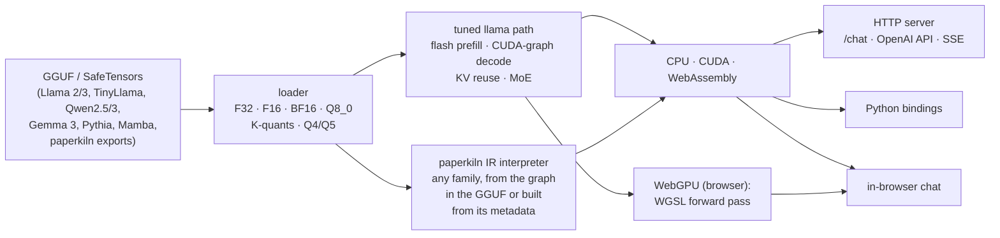
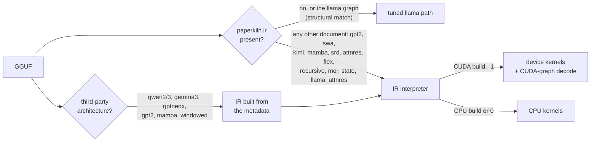

# ember.cpp

**A from-scratch C++ inference engine for Llama-family models, for third-party Qwen, Gemma 3,
Pythia and Mamba GGUFs, and for every architecture
[paperkiln](https://github.com/JohnnyTeutonic/paperkiln) trains, on CPU, CUDA, WebAssembly
and, in the browser, the visitor's own GPU.**

*Formerly `tinyllama.cpp` (renamed 2026-08-01; GitHub redirects the old URL). The binaries
keep their old names, `tinyllama` and `tinyllama_server`.*

**[▶ Chat with a model trained from scratch, running in your browser](https://huggingface.co/spaces/johnnyteutonic/ember-chat)**:
the 97.5M-parameter pk_sft_v1 paperkiln model (F16, 221 MB), served by ember.cpp
compiled to WebAssembly. Nothing you
type leaves the page.



## What it runs

| Model family | How | CPU | CUDA | WASM | WebGPU |
|---|---|:---:|:---:|:---:|:---:|
| Llama 2/3, TinyLlama (GGUF, SafeTensors) | tuned path | ✅ | ✅ | ✅ | ✅ (f32, Q8_0) |
| paperkiln llama chat models | tuned path | ✅ | ✅ | ✅ | ✅ |
| Mixture of experts (llama.cpp expert layout) | tuned path, routed experts | ✅ | ✅ | ✅ | ✅ |
| GPT-2 (layernorm, GELU, learned positions) | IR interpreter | ✅ | ✅ | ✅ | ✅ |
| Sliding-window attention with sinks | IR interpreter | ✅ | ✅ | ✅ | ✅ |
| Kimi linear attention (recurrent state) | IR interpreter | ✅ | ✅ | ✅ | ✅ |
| Mamba-style state-space scan | IR interpreter | ✅ | ✅ | ✅ | ✅ |
| SRD, AttnRes, flex (highway, plain residual) | IR interpreter | ✅ | ✅ | ✅ | ✅ |
| Runtime-defined ops (`expr`: a paper's new activation or gate as a formula) | IR interpreter | ✅ | ✅ | not gated | ✅ |
| Tied-block recursion (`weight_index`: one stored block applied several times) | IR interpreter | ✅ | ✅ | not gated | ✅ |
| Mixture-of-Recursions (`depth_route`: each token picks its depth) | IR interpreter | ✅ | ✅ | not gated | ✅ |
| Per-turn state tokens with eviction (`turn_state`) | IR interpreter | ✅ | ✅ | ✅ | ✅ (every row kept) |
| Attention residuals over depth (`llama_attnres`) | IR interpreter | ✅ | ✅ | ✅ | ✅ |
| `llama_attnres` under tied-block recursion (`tensor_index`: each application reads its own pseudo-queries) | IR interpreter | ✅ | ✅ | ✅ | ✅ |
| Recurrent ops the document defines (`recurrence`: a paper's new state-space model or linear attention as data) | IR interpreter | ✅ | runs on the CPU | ✅ | ✅ |

The core paperkiln parity gates compare **greedy replies with paperkiln's own sampler on
40 frozen prompts**, including a trained 70M mixture-of-experts model. Backend coverage and
exceptions are stated in the table; receipts are in [`experiments/`](experiments/). "Runs on the CPU" means a CUDA build
serves that family on its CPU path, because the device kernels for it are not written yet. The WebGPU column of the
IR rows is gated on a software adapter (SwiftShader), against ember's CPU interpreter: greedy 40/40, the
top-1 at every position and logits within 1.5e-6 of the range, plus the page's chat path against
WebAssembly and ember's CPU replies ([`experiments/webgpu_ir_2026-10-26/`](experiments/webgpu_ir_2026-10-26/),
[`experiments/tensor_index_gate_2026-10-27/`](experiments/tensor_index_gate_2026-10-27/),
[`experiments/webgpu_recurrence_2026-10-27/`](experiments/webgpu_recurrence_2026-10-27/));
hardware speed measurements cover the subset linked below.

The last four rows serve paperkiln's research programme,
[tiny chat from scratch](https://github.com/JohnnyTeutonic/paperkiln#research-programme-tiny-chat-from-scratch):
pre-registered studies of how small models, trained only on human-written text, carry a
conversation over 5 and then 12 turns (data mix, depth against width, recursion, state tokens).
ember serves every arm's models and checks paperkiln's generation in its post jobs.

**Third-party GGUFs.** A llama.cpp GGUF with no `paperkiln.ir` gets its graph built from its
metadata at load (`build_ir_from_gguf`, a C++ port of keramos's `tools/gguf_ir.py`, node for
node) and runs on the interpreter:

| Family and checked checkpoint | What the graph has | CPU | CUDA | WASM | WebGPU |
|---|---|:---:|:---:|:---:|:---:|
| Qwen2.5 (0.5B-Instruct, f16) | q/k/v biases, NEOX RoPE, tied head, ChatML | ✅ | ✅ | ✅ | ✅ (L4, 6 prompts) |
| Qwen3 (0.6B, Q8_0 read in place) | per-head q/k RMSNorm | ✅ | ✅ | ✅ | ✅ (L4, 6 prompts) |
| Gemma 3 (270m-it) | sliding window on 5 of every 6 layers, per-layer RoPE base, sandwich norms, GeGLU | ✅ | ✅ | ✅ | ✅ (L4, 6 prompts) |
| GPT-NeoX / Pythia (160m) | partial NEOX rotary, parallel residual, exact GELU | ✅ | ✅ | ✅ | ✅ |
| Mamba-1 (130m) | causal depthwise convolution and selective scan, recurrent state | ✅ | ✅ | ✅ | ✅ |
| Mistral (sliding window) | the window as an attribute on the llama graph | ✅ | ✅ | ✅ | ✅ (tiny random model) |
| GPT-2 (124M) | fused qkv, LayerNorm, learned positions | ✅ | ✅ | ✅ | ✅ (tiny random model) |
| Gemma 2; Phi-3 LongRoPE and sliding window (synthetic) | soft caps, scaled rotary and windows | ✅ | ✅ | ✅ | not gated |
| Mixtral; Qwen2-MoE; Qwen3-MoE (synthetic) | routed/shared experts; explicit IR path | ✅ | ✅ | ✅ | not gated |
| DeepSeek2 and query-LoRA (synthetic) | multi-head latent attention | ✅ | ✅ | ✅ | not gated |
| DeepSeek2 dense/YaRN; DeepSeek3 (synthetic) | leading dense layers and grouped router | ✅ | CPU fallback | ✅ | not gated |

How they are checked:
- **The graph.** The IR ember builds equals `gguf_ir.py`'s field by field, on every family.
- **CPU.** Every position's top-1 agrees with paperkiln's numpy evaluation of the same IR, and
  decode equals prefill. Qwen2.5 and Qwen3 also give greedy replies identical to HF transformers
  on 40/40 chat prompts, with ember's own tokeniser and template, and GPT-2 124M on 40/40 raw
  prompts with HF's token ids ([`experiments/gpt2_2026-10-25/`](experiments/gpt2_2026-10-25/)).
  The tokeniser applies Unicode NFC between the added tokens, as HF's does: its ids equal HF's on
  337 strings that NFC changes
  (decomposed accents, Hangul jamo, combining sequences, compatibility characters NFC keeps, mixed
  scripts), raw and templated ([`experiments/qwen_nfc_2026-10-25/`](experiments/qwen_nfc_2026-10-25/)).
- **CUDA.** CUDA against the CPU interpreter on 40 prompts: greedy replies identical (40/40) and
  the top-1 agreeing at every position, on a laptop RTX 4060 and a Colab L4. Pythia flipped one
  position in 960 on the RTX 4060 and none on the L4, where it is 960/960.
- **Long prompts.** Chat prompts past 512 tokens (up to 1,324), so Gemma 3's sliding window and
  long-context RoPE are in play: Gemma-3-270m, Qwen2.5 and Qwen3 give identical greedy replies on
  CUDA and the CPU, and Gemma's CPU top-1 agrees with numpy, closer to HF than numpy is. Receipts:
  [`experiments/thirdparty_2026-10-22/device_gate/`](experiments/thirdparty_2026-10-22/device_gate/).
- **Real checkpoints and float32.** On real checkpoints, logit closeness is judged against a
  float64 evaluation of the same graph, because float32 conditioning grows with depth: on
  Mamba-130m and GPT-2 124M ember is closer to float64 than numpy's float32 is.
- **Scope.** The CPU column was checked on official checkpoints for every family except Mistral,
  which was checked on a tiny random model. CUDA and WASM for Mistral and GPT-2 were checked on
  tiny random models.
- **WASM.** The interpreter compiled to WebAssembly (the page's sources and flags, in node) against
  ember's CPU build, on the CUDA leg's prompts: greedy replies identical and the top-1 agreeing at
  every position, on all 40 prompts per family (960/960), and on 10 for Qwen2.5 and Qwen3 (240/240;
  a 0.5B model takes 1-3 minutes per prompt in WebAssembly). The official checkpoints need the 4 GB
  heap (`EMBER_WASM_MAX_MEMORY=4gb`; Pythia and Mamba fail to load in the 1 GB default). Logits
  agree within 2.0e-5 of the range, and Pythia's within 3.6e-4, the level its CUDA leg shows (up to
  3.9e-4) ([`experiments/wasm_families_2026-10-25/`](experiments/wasm_families_2026-10-25/)). The
  page caps the KV state at 2048 positions; uncapped, Qwen3-0.6B's declared context needs 9.4 GB.
  With the cap, Qwen3-0.6B and Qwen2.5-0.5B load in the 4 GB build, and the page's chat replies equal
  ember's CPU server's with the same cap, 10/10 each
  ([`experiments/wasm_ctx_2026-10-25/`](experiments/wasm_ctx_2026-10-25/)).
- **WebGPU.** The page's WGSL interpreter (`deploy/wasm/web/webgpu/ir_webgpu.js`) on a software adapter
  (SwiftShader, CPU only: no GPU work on the laptop) against ember's CPU build, on the WASM leg's
  prompts: greedy replies identical and the top-1 agreeing at every position on Pythia-160m and
  Mamba-130m (40/40, 960/960) and on the tiny Mistral and GPT-2 models; logits within 1.6e-4 (Pythia)
  and 3.3e-4 (Mamba) of the range, the float32 level of their CUDA legs (2.0e-4, 1.0e-4). Gemma-3-270m
  and Qwen2.5-0.5B were not run: the laptop lacked the memory for a software-adapter copy of them
  ([`experiments/webgpu_ir_2026-10-26/`](experiments/webgpu_ir_2026-10-26/)).

The later-family synthetic gate passed all ten files on an L4: eight actually executed on CUDA,
two used the named CPU fallbacks above. Each matched 40 HF continuations and 640 CPU/device
argmaxes; deterministic repeats matched every saved row bit. Mixtral used `EMBER_IR_BUILD=1`:
this result validates its IR path, while the attempted tuned-path harness failed to produce an
IR document. These small synthetic models do not establish full checkpoint support or speed
([E4 receipts](experiments/e4_moe_mla_2026-10-28/README.md)).

The three official Gemma/Qwen WebGPU entries also have actual L4 browser measurements against
WebAssembly, with identical replies on six prompts each. Those GPU-specific checks supplement
the earlier software-adapter gates; browser memory limits still depend on the device and build
([hardware WebGPU receipts](experiments/webgpu_gpu_2026-10-27/README.md)).

**Highlights**

- **CUDA graph decode and batched prefill.** Historical tuned-path measurements show prefill
  7.5x to 188x faster than its original implementation, up to 4,096 tokens, with 2.7 ms/token
  decode and a first streamed word in 16–20 ms on an RTX 4060. These are the recorded models
  and workloads, not a comparison with another engine ([docs/TTFT.md](docs/TTFT.md)).
- **Reproducible when asked.** `EMBER_DETERMINISTIC=1` makes CUDA prefill and decode logits bit-identical run
  to run on the same GPU and build (fixed-order decode reductions, pinned cuBLAS workspace), at no measurable
  cost; off by default, and off changes nothing
  ([docs/USAGE.md](docs/USAGE.md), [`experiments/determinism_2026-10-26/`](experiments/determinism_2026-10-26/)).
- **The visitor's GPU, in the browser.** The chat page runs the forward pass through WebGPU when
  the browser has it, and falls back to WebAssembly when it does not. On an Intel laptop GPU,
  the earlier `chat_sftfinal_v3` page measured 166 ms per reply against 646 ms for WebAssembly,
  with identical replies on 40 prompts. This is not a latency claim for the current 97.5M chat
  model. Q8_0 weights stay quantised on the GPU; the tables above distinguish software and
  hardware checks for the IR families ([browser receipts](experiments/webgpu_2026-10-21/README.md)).
- **Any paperkiln network, not just llama.** paperkiln writes the model's graph into the GGUF
  (`paperkiln.ir`). ember's interpreter runs it on the CPU or GPU, with a CUDA-graph decode of
  its own, and refuses at load any op it cannot run, naming it.
- **Quantised models.** Q8_0, the K-quants Q4_K, Q5_K and Q6_K, and Q4_0/Q4_1/Q5_0/Q5_1, on the
  tuned path and the IR interpreter. Every format is bit-identical to gguf-py's reference
  dequantiser and is multiplied with the F32 kernels, so a quantised file gives exactly the logits of
  the F32 file gguf-py dequantises it to, on CPU and CUDA. Gated on paperkiln's pk_base_v1 Q4_K_M and
  Q4_K_S (llama.cpp's own mixes, byte for byte): CUDA replies equal the CPU's 40/40; against the F32
  model 36/40 first tokens and 14/40 whole replies, since 4-bit trades fidelity for size
  ([`experiments/kquant_2026-10-25/`](experiments/kquant_2026-10-25/)). Every stored type's values
  are IR_SPEC 4.7's (ggml b6000's scalar dequantisers), bit for bit on the conformance suite's blocks
  on the CPU and in WebAssembly, signed zeros and negative scales included.
- **Serving features.** Server-sent-event streaming, an OpenAI-compatible API, KV prefix reuse
  across turns, speculative decoding, and a hardened public mode. The repetition penalty is
  defined jointly with paperkiln, and replies match mtstudio 40/40 at penalties 1.1 and 1.3 on
  CPU, CUDA and WebAssembly.
- **From checkpoint to the public chat in one command.** `tools/release_chat.py` exports, gates,
  evaluates and builds the browser page, and publishes only when told to.
- **Proved, not assumed.** Parity tools in [`tools/`](tools/) compare ember with paperkiln token
  by token. Kernel tests check the attention, MoE and recurrent kernels against
  double-precision references.

## Current performance evidence

The matched single-thread FP32 CPU comparison uses the same F32 GGUFs, frozen token IDs and
full vocabulary rows in Ember and Transformers: SmolLM2-135M and Gemma3-270M, at 16/128/512
prompt tokens with 32 output rows. Both models passed the fixed numerical and greedy-ID gates.
The portable Ember build was slower in every cell. The subsequent AVX2 change preserved all
192 captured rows bit for bit and improved prefill by 2.38–2.87x and decode by 1.04–1.50x over
that build; the optimized cells remain slower than Transformers. The paired trials, arithmetic
and timing boundaries, host limits and independent audit are in the
[CPU comparison](experiments/hf_cpu_2026-10-30/README.md). These are laptop workload results,
not a general engine ranking. A separate Smol-only CUDA comparison is supervised and pending;
there is no completed CUDA-versus-Transformers speed claim here.

Recent optional decode experiments have not justified changing defaults. Fixed-linear logits
passed the registered rounding tolerance but failed the stronger requirement of being no farther
from the CPU reference than cuBLAS. Device row selection had an unstable default off/off control;
its deterministic paired speedups were 1.159x and 1.141x, so only one of the two required pairs
cleared 1.15x.
The f16 KV-cache gate retained greedy IDs but failed the unchanged CPU/device logit tolerance on
Qwen3. These outcomes remain recorded, with no tolerance changes or default switch
([fixed linear and row selection](experiments/spec_r1_2026-10-28/README.md),
[KV cache](experiments/kv_quant_r2_2026-10-28/README.md)). Self-output draft tables currently have
only a supervised timing pilot, not a completed quality or speed result.

## Quick start: build and chat

```bash
git clone https://github.com/JohnnyTeutonic/ember.cpp.git && cd ember.cpp
cmake -S . -B build -DCMAKE_BUILD_TYPE=Release
cmake --build build --parallel 2 --target tinyllama_server
./build/tinyllama_server path/to/model.gguf 8080 127.0.0.1 ./www -1   # -1: all layers on the GPU, 0: CPU
```

Open http://127.0.0.1:8080. You need CMake, a C++17 compiler and Boost; CUDA and OpenMP are
optional (details: [docs/USAGE.md](docs/USAGE.md)). For an explicit CPU build, add
`-DHAS_CUDA=OFF` to the configure command and pass `0` instead of `-1` to the server.
Use a compatible [paperkiln](https://github.com/JohnnyTeutonic/paperkiln) export or one of the
supported GGUF families above; unsupported operators or configurations are refused at load.
`curl http://127.0.0.1:8080/health` reports the loaded model and selected chat template.

## Quick start: OpenAI-compatible API

```bash
curl http://127.0.0.1:8080/v1/chat/completions -H "Content-Type: application/json" \
  -d '{"messages": [{"role": "user", "content": "Hello!"}], "stream": false}'
```

`"stream": true` streams the reply token by token, and `GET /v1/models` lists the model. The
native `POST /chat` takes `{user_input, history, system, thinking, temperature, top_k, top_p,
seed, max_new_tokens, repeat_penalty, repeat_last_n}`, the same contract as paperkiln's
`mtstudio chat`. A model with paperkiln's conversation schema v2 (`paperkiln/2`) also takes
`tools`, tool calls and tool results on both endpoints, and returns the calls it makes as
OpenAI-form `tool_calls`, streamed whole ([docs/USAGE.md](docs/USAGE.md)).

**One conversation schema.** The chat template is data in the GGUF (`paperkiln.chat_template`,
plus the standard `tokenizer.chat_template` for llama.cpp, Ollama and LM Studio), shared with
paperkiln through one header, so both engines render every prompt identically.
- **System messages:** a system message works on `/chat`, the OpenAI endpoint and the browser.
  On paperkiln's v1 template it is folded into the first user turn, as Gemma does.
- **Thinking:** Qwen3's thinking switch is `thinking` (or `chat_template_kwargs.enable_thinking`).
- **Malformed histories:** these are refused, with the rule named.
- **Status:** `/health` reports which template a model resolved to, and why.

## Quick start: Python

```bash
pip install .            # CUDA: TINYLLAMA_CPP_BUILD_CUDA=1 pip install .
```

```python
import tinyllama_cpp
s = tinyllama_cpp.TinyLlamaSession(model_path="model.gguf", tokenizer_path="model.gguf",
                                   threads=4, n_gpu_layers=-1)
print(s.generate("What is AI?", steps=64))
```

## Quick start: in the browser

```bash
JSON_INC=<dir with nlohmann/json.hpp> bash deploy/wasm/build.sh out/    # needs Emscripten
bash tools/build_wasm_space.sh model.gguf out/ space/                   # the static chat page
```

`space/` is the whole site: open `index.html` from any static server.
- **Backends:** the page's worker uses WebGPU when the browser offers it
  (`deploy/wasm/web/webgpu/`) and otherwise WebAssembly SIMD; `?backend=wasm` forces the CPU. It
  follows ember's choice of path (`ember_ir_doc`): `llama_webgpu.js` for files on the tuned llama path,
  `ir_webgpu.js` for any other IR document whose ops it has, WebAssembly for the rest.
- **Larger models:** `EMBER_WASM_MAX_MEMORY=4gb` raises the WebAssembly heap (a 70M f32 MoE
  needs it).
- **Context cap:** the KV state holds at most 2048 positions (`EMBER_WASM_CTX=N` at build, `?ctx=N`
  on the page's URL, 0 for none), as `EMBER_IR_CTX` does natively; a file with a smaller context
  keeps its own. Third-party files declare their whole trained context (Qwen3-0.6B: 40,960
  positions, 9.4 GB of f32 KV); with the cap, Qwen3-0.6B and Qwen2.5-0.5B run in the 4 GB build.
  Longer conversations follow the context rule: the oldest exchanges are dropped and the system
  message is kept. See [docs/USAGE.md](docs/USAGE.md#the-browser-page-deploywasm).
- **Threads:** `EMBER_WASM_THREADS=4` builds a pthreads variant for cross-origin-isolated pages.

[`tools/webgpu_parity/`](tools/webgpu_parity/) checks that the page gives the same replies on
both backends.

## Quick start: release a chat model

```bash
python3 tools/release_chat.py build --spec run/spec.json --ckpt run/model.safetensors --out rel/ \
  --mtstudio paperkiln/build/mtstudio --ember-cpu build/tinyllama_server --paperkiln paperkiln/
python3 tools/release_chat.py publish --out rel/ --env-file .env --confirm ember-chat   # only on the go-ahead
```

`build` runs five stages:
1. export;
2. the parity gate, f32 40/40 against mtstudio and Q8 on logits;
3. evals;
4. the WebAssembly build;
5. the Space folder.

Each stage leaves a receipt in `rel/release.json` and is skipped when rerun.

## Quick start: any paperkiln architecture

Export a model from paperkiln (`mtstudio run spec.json`; the GGUF carries its IR) and serve it
as above. ember picks the engine itself:



`EMBER_INTERPRETER=1` runs a llama model through the interpreter too, which is how the
interpreter is checked against the tuned path. A document takes the tuned path only when it is,
node for node, the graph that path implements, with the numbers the file's llama metadata gives
(`ember_ir::tuned_llama_match`; `family_hint` is only a pre-filter, as paperkiln's IR_SPEC 9.1
requires); `tools/ir_path_check` says which path serves a file.

Every document is checked at load against the IR specification, keramos at v1.3.0 (spec revision 1.3;
paperkiln vendors it at `spec/`; `IR_SPEC.md` section 10.1, the rules its `tools/ir_validate.py` checks), with
its JSON Schema vendored in `graph_ir_schema.h` (`tools/ir_schema_header.py --check` compares it with keramos's):
an attribute an op does not define, a missing required attribute, a member name written twice, a value read
before any node writes it, a slot nobody reads or a container key that disagrees is refused, citing the rule.
A file whose `general.architecture` is a llama.cpp architecture must hold that architecture's graph (rule 38:
the embedded document is compared with the one ember builds from the file's metadata), so an IR-only model
labelled "gpt2" is refused at load rather than served as GPT-2; such files are relabelled "paperkiln"
(keramos `tools/gguf_relabel.py`). `tools/ir_doc_check` checks documents without a GGUF, and
`tools/ir_adapter` runs keramos's conformance suite, 355 pass, 0 fail, 49 skip at v1.3.0
(`experiments/ir_rev13_2026-10-27`; earlier `experiments/ir_spec_2026-10-25`,
`experiments/ir_rev11_2026-10-25`).

T5's relative position bias travels as an attention attribute (`position_bias`: a bucket table read by
distance, IR_SPEC 5.15): the CPU interpreter adds it after the scaled product, with windows, sinks and
grouped-query attention; a CUDA build serves such a document on its CPU path.

A third-party GGUF with no `paperkiln.ir` gets its IR built from the llama.cpp metadata at load
when its `general.architecture` is `qwen2`, `qwen3`, `gemma3`, `gptneox`, `gpt2` or `mamba`, or
`llama`/`mistral` with an `attention.sliding_window` (a plain llama or mistral file keeps the tuned
path; `EMBER_IR_BUILD=1` sends it through the interpreter as well). Chat templates are data:
each GGUF's template resolves at load to a record (paperkiln's `chat_template.h`: a declared
`paperkiln.chat_template`, paperkiln's specials, or a third-party record matched by
`tokenizer.chat_template` or by its markers and architecture), and every prompt is rendered from
it. Qwen2.5 and Qwen3 files chat with Qwen's tokeniser and their ChatML records (Qwen3 with its
thinking switch), Gemma 3 with its SentencePiece vocabulary and turn template, each equal to HF's
`apply_chat_template` token for token (experiments/chat_template_2026-10-24):
`./build/tinyllama_server qwen2.5-0.5b-instruct-fp16.gguf 8080 127.0.0.1 ./www -1`.
`EMBER_IR_CTX=N` caps the KV state, since these files declare their full trained context. Any other
architecture without an IR is refused at load, naming it.

A paper's new elementwise op travels as an `expr` node: a formula in paperkiln's closed grammar
(`max(x, 0)^2`, `x * sigmoid(1.702 * x)`, row reductions such as `rowmax`). ember parses it at load
with paperkiln's own parser and runs it on the CPU and, compiled to a small per-element program, on
CUDA.

A paper's new recurrent op travels as a `recurrence` node (IR_SPEC 6.10, spec revision 1.1): a state
of indexed tensors, its initial value, a per-token update and a readout, each a body in `expr`'s
grammar plus indexed reads (`x[k + 1, c]`, zero outside the shape), index values and an ordered
`sum(j, ...)`. ember's own parser and evaluator (`graph_ir_recurrence.h`, written from the
specification text) run it token by token on the CPU: the whole new state from the old, then the
readout, every primitive rounded in f32 with no fused multiply-add, so prefill equals token-by-token
decode bit for bit, and snapshots, truncation and rewinds work as for the hand-written recurrent
ops. Kimi's linear attention, the SSM scan, Mamba-1's convolution and selective scan rewritten as
recurrences give ember's hand-written ops' logits bit for bit (the selective scan within 1.4e-7).
A CUDA build serves such a document on its CPU path. A document that breaks the profile's rules is
refused at load, naming rule 31 to 34.

Every GGUF that carries `paperkiln.ir_sha256` is checked at load: the key must be the digest of the
embedded document (IR_SPEC 3.10: SHA-256 of its RFC 8785 serialisation without the `_` prose keys,
`ir_digest.h`, written from the specification text), also when another document is run in its place
(`EMBER_IR`). The log names the digest of the document run (`[IR] document sha256:...`), so a paper
can cite exactly what ran. Results: [`experiments/ir_rev11_2026-10-25/`](experiments/ir_rev11_2026-10-25/).

## Quick start: check a model against paperkiln

```bash
# ember on 8095, mtstudio chat on 8096, same model:
PARITY_EMBER_PORT=8095 PARITY_MTS_PORT=8096 PARITY_GGUF=model.gguf python3 tools/chat_parity.py 40
python3 tools/chat_ctx_parity.py 8095 8096 256      # long replies, long histories, over-long messages
python3 tools/quantize_gguf.py model.gguf model_q8.gguf --output-q8 --embed-q8   # Q8_0 (or --dequantize)
```

## Quick start: score benchmarks by log-probability

```bash
curl http://127.0.0.1:8080/score -H "Content-Type: application/json" \
  -d '{"requests": [{"key": "q1|0", "prompt_ids": [0, 412, 88], "continuation_ids": [93, 17]}]}'
```

`POST /score` gives each continuation's per-token log-probabilities, the argmax at each of its
positions and their sum, with the semantics of paperkiln's `mtstudio score`, so paperkiln's
`tools/bench_eval.py --scorer ember` runs HellaSwag, ARC, PIQA, WinoGrande, LAMBADA and BLiMP
through ember. Requests sharing a prefix reuse its KV rows on the CPU without changing a bit. On
paperkiln's pick_e1_L16 and pk_base_v1 the log-probabilities agree with mtstudio's within ROUNDING
(worst 1.1e-5, with ember nearer a float64 evaluation), argmax 2732/2732. Pythia-160m, Qwen2.5-0.5B
and SmolLM2-135M agree with HF transformers within 8.3e-6 of the logit range, argmax equal
everywhere, and on a T4 the device matches the CPU at 17-53 requests/s
([docs/USAGE.md](docs/USAGE.md), [`experiments/score_2026-10-26/`](experiments/score_2026-10-26/)).

## Landing next

Recently landed:
- **Log-probability scoring for benchmarks.** `POST /score`, above. GGUFs without `output.weight`
  (a tied head, such as SmolLM2's) now run on the tuned llama path.
- **A llama.cpp-compatible vocabulary.** paperkiln's 97.5M base (pk_base_v1, d768 L12) and its
  chat fine-tunes use the 16,384-token Llama 3 scheme, so llama.cpp, Ollama and LM Studio can
  tokenise them too. They give ember chat replies identical to mtstudio's, 40/40.
- **The conversation schema** (above), gated against mtstudio and against HF's
  `apply_chat_template` for Qwen2.5, Qwen3 and Gemma 3.
- **Per-turn state tokens on CUDA and in WebAssembly.** The turn_state mask and eviction run on
  the device, with greedy 40/40 and logits within 1.1e-6 of the CPU on paperkiln's state4, rewinds
  into evicted turns included (`experiments/cuda_state_2026-10-25`). In WebAssembly, state4 and the
  attention-residual model ar3 give greedy 40/40 and logits within 3.8e-7 of the CPU, with
  eviction exact (`experiments/wasm_state_2026-10-25`).
- **Mixture-of-Recursions on CUDA.** Each recursion step runs batched over its active tokens, at
  their absolute positions, into each application's compact kv cache; the routing is the CPU's
  code on the device's router logits. On paperkiln's mor3 and mor2p0 a T4 gives greedy 40/40,
  logits within 2.0e-7 of the CPU, depth traces and kv rows held equal to the CPU's, and rewinds
  160/160. The tiny-chat MoR3 model decodes in 1.4 ms per token there, against 24 ms on the CPU
  (`experiments/mor_cuda_2026-10-25`).

In progress:
- **The research programme's models.** These are training on Colab and RunPod: the 20M and 60M
  depth sweeps, recursion and Mixture-of-Recursions arms, and then a 12-turn model.
- **A new public chat model.** pk_base_v1's chat model, released through `release_chat.py`
  with the WebGPU page.

## More

| | |
|---|---|
| Every option, endpoint, switch and the source layout | [docs/USAGE.md](docs/USAGE.md) |
| Time-to-first-token work and its method | [docs/TTFT.md](docs/TTFT.md) |
| Measured results, one folder per study | [experiments/](experiments/) |
| API reference (Doxygen) | [johnnyteutonic.github.io/ember.cpp](https://johnnyteutonic.github.io/ember.cpp/), built by the docs workflow |
| The training side | [paperkiln](https://github.com/JohnnyTeutonic/paperkiln) |
| The research programme ember serves | [paperkiln: tiny chat from scratch](https://github.com/JohnnyTeutonic/paperkiln#research-programme-tiny-chat-from-scratch) |

## License

[MIT](LICENSE), as declared in `pyproject.toml`. Original project material is copyright (c) 2024-2026 Jonathan Reich.
Third-party components retain their notices and terms; see [Third-party notices](THIRD_PARTY_NOTICES.md).
