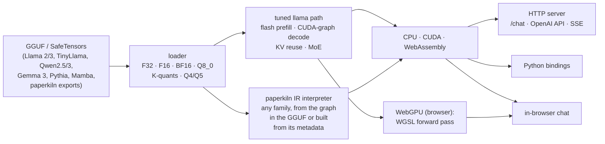
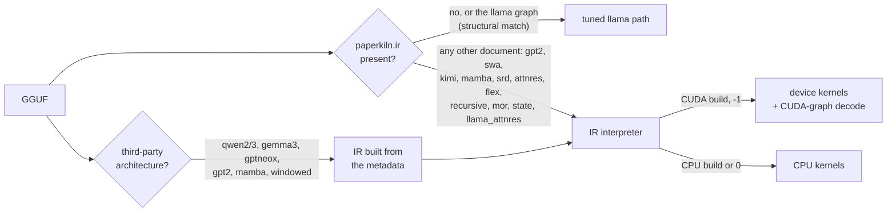

# ember.cpp

**A from-scratch C++ inference engine for Llama-family models, for third-party Qwen, Gemma 3,
Pythia and Mamba GGUFs, and for every architecture
[paperkiln](https://github.com/JohnnyTeutonic/paperkiln) trains, on CPU, CUDA, WebAssembly
and, in the browser, the visitor's own GPU.**

*Formerly `tinyllama.cpp` (renamed 2026-08-01; GitHub redirects the old URL). The binaries
keep their old names, `tinyllama` and `tinyllama_server`.*

**[▶ Chat with a model trained from scratch, running in your browser](https://huggingface.co/spaces/johnnyteutonic/ember-chat)**:
a 14.6M-parameter paperkiln model, served by ember.cpp compiled to WebAssembly. Nothing you
type leaves the page.



## What it runs

| Model family | How | CPU | CUDA | WASM | WebGPU |
|---|---|:---:|:---:|:---:|:---:|
| Llama 2/3, TinyLlama (GGUF, SafeTensors) | tuned path | ✅ | ✅ | ✅ | ✅ (f32, Q8_0) |
| paperkiln llama chat models | tuned path | ✅ | ✅ | ✅ | ✅ |
| Mixture of experts (llama.cpp expert layout) | tuned path, routed experts | ✅ | ✅ | ✅ | ✅ |
| GPT-2 (layernorm, GELU, learned positions) | IR interpreter | ✅ | ✅ | ✅ | |
| Sliding-window attention with sinks | IR interpreter | ✅ | ✅ | ✅ | |
| Kimi linear attention (recurrent state) | IR interpreter | ✅ | ✅ | ✅ | |
| Mamba-style state-space scan | IR interpreter | ✅ | ✅ | ✅ | |
| SRD, AttnRes, flex (highway, plain residual) | IR interpreter | ✅ | ✅ | ✅ | |
| Runtime-defined ops (`expr`: a paper's new activation or gate as a formula) | IR interpreter | ✅ | ✅ | not gated | |
| Tied-block recursion (`weight_index`: one stored block applied several times) | IR interpreter | ✅ | not gated | not gated | |
| Mixture-of-Recursions (`depth_route`: each token picks its depth) | IR interpreter | ✅ | runs on the CPU | not gated | |
| Per-turn state tokens with eviction (`turn_state`) | IR interpreter | ✅ | ✅ | not gated | |
| Attention residuals over depth (`llama_attnres`) | IR interpreter | ✅ | ✅ | not gated | |

Every paperkiln family is gated the same way: **greedy replies identical to paperkiln's own
sampler on 40 frozen prompts**, on each backend, including a trained 70M mixture-of-experts
model. The receipts are in [`experiments/`](experiments/). "Runs on the CPU" means a CUDA build
serves that family on its CPU path, because the device kernels for it are not written yet.

The last four rows serve paperkiln's research programme,
[tiny chat from scratch](https://github.com/JohnnyTeutonic/paperkiln#research-programme-tiny-chat-from-scratch):
pre-registered studies of how small models, trained only on human-written text, carry a
conversation over 5 and then 12 turns (data mix, depth against width, recursion, state tokens).
ember serves every arm's models and checks paperkiln's generation in its post jobs.

**Third-party GGUFs.** A llama.cpp GGUF with no `paperkiln.ir` gets its graph built from its
metadata at load (`build_ir_from_gguf`, a C++ port of paperkiln's `tools/gguf_ir.py`, node for
node) and runs on the interpreter:

| Family (official checkpoint gated) | What the graph has | CPU | CUDA | WASM |
|---|---|:---:|:---:|:---:|
| Qwen2.5 (0.5B-Instruct, f16) | q/k/v biases, NEOX RoPE, tied head, ChatML | ✅ | ✅ | not gated |
| Qwen3 (0.6B, Q8_0 read in place) | per-head q/k RMSNorm | ✅ | ✅ | not gated |
| Gemma 3 (270m-it) | sliding window on 5 of every 6 layers, per-layer RoPE base, sandwich norms, GeGLU | ✅ | ✅ | not gated |
| GPT-NeoX / Pythia (160m) | partial NEOX rotary, parallel residual, exact GELU | ✅ | ✅ | not gated |
| Mamba-1 (130m) | causal depthwise convolution and selective scan, recurrent state | ✅ | ✅ | not gated |
| Mistral (sliding window) | the window as an attribute on the llama graph | ✅ | ✅ | not gated |
| GPT-2 | fused qkv, LayerNorm, learned positions | ✅ | ✅ | not gated |

How they are checked:
- **The graph.** The IR ember builds equals `gguf_ir.py`'s field by field, on every family.
- **CPU.** Every position's top-1 agrees with paperkiln's numpy evaluation of the same IR, and
  decode equals prefill. Qwen2.5 and Qwen3 also give greedy replies identical to HF transformers
  on 40/40 chat prompts, with ember's own tokeniser and template. The tokeniser applies Unicode
  NFC between the added tokens, as HF's does: its ids equal HF's on 337 strings that NFC changes
  (decomposed accents, Hangul jamo, combining sequences, compatibility characters NFC keeps, mixed
  scripts), raw and templated ([`experiments/qwen_nfc_2026-10-25/`](experiments/qwen_nfc_2026-10-25/)).
- **CUDA.** CUDA against the CPU interpreter on 40 prompts: greedy replies identical (40/40) and
  the top-1 agreeing at every position, on a laptop RTX 4060 and a Colab L4. Pythia flipped one
  position in 960 on the RTX 4060 and none on the L4, where it is 960/960.
- **Long prompts.** Chat prompts past 512 tokens (up to 1,324), so Gemma 3's sliding window and
  long-context RoPE are in play: Gemma-3-270m, Qwen2.5 and Qwen3 give identical greedy replies on
  CUDA and the CPU, and Gemma's CPU top-1 agrees with numpy, closer to HF than numpy is. Receipts:
  [`experiments/thirdparty_2026-10-22/device_gate/`](experiments/thirdparty_2026-10-22/device_gate/).
- **Real checkpoints and float32.** On real checkpoints, logit closeness is judged against a
  float64 evaluation of the same graph, because float32 conditioning grows with depth: on
  Mamba-130m ember is closer to float64 than numpy's float32 is.
- **Scope.** The CPU column was checked on official checkpoints for every family except Mistral
  and GPT-2, which were checked on tiny random models. The CUDA column covers both.
- **WASM.** WebAssembly compiles the same CPU interpreter, but no third-party family has been
  gated in the browser yet.

**Highlights**

- **Fast where it matters.** CUDA prefill is 7.5x to 188x faster than the original path, up to
  4,096 tokens ([docs/TTFT.md](docs/TTFT.md)). A whole decode step is captured as one CUDA
  graph: 2.7 ms/token and a first streamed word in 16-20 ms on a laptop RTX 4060.
- **The visitor's GPU, in the browser.** The chat page runs the forward pass through WebGPU when
  the browser has it, and falls back to WebAssembly when it does not. On an Intel laptop GPU it
  answers in 166 ms per reply against 646 ms for WebAssembly, with replies identical to ember's
  CPU on all 40 prompts. Q8_0 weights stay quantised on the GPU.
- **Any paperkiln network, not just llama.** paperkiln writes the model's graph into the GGUF
  (`paperkiln.ir`). ember's interpreter runs it on the CPU or GPU, with a CUDA-graph decode of
  its own, and refuses at load any op it cannot run, naming it.
- **Quantised models.** Q8_0, K-quants, and Q4_0/Q4_1/Q5_0/Q5_1. The legacy formats are
  bit-identical to the reference dequantiser and can stay in their blocks for large models.
- **Serving features.** Server-sent-event streaming, an OpenAI-compatible API, KV prefix reuse
  across turns, speculative decoding, and a hardened public mode. The repetition penalty is
  defined jointly with paperkiln, and replies match mtstudio 40/40 at penalties 1.1 and 1.3 on
  CPU, CUDA and WebAssembly.
- **From checkpoint to the public chat in one command.** `tools/release_chat.py` exports, gates,
  evaluates and builds the browser page, and publishes only when told to.
- **Proved, not assumed.** Parity tools in [`tools/`](tools/) compare ember with paperkiln token
  by token. Kernel tests check the attention, MoE and recurrent kernels against
  double-precision references.

## Quick start: build and chat

```bash
git clone https://github.com/JohnnyTeutonic/ember.cpp.git && cd ember.cpp
mkdir -p build && cd build && cmake .. -DCMAKE_BUILD_TYPE=Release && make -j && cd ..
./build/tinyllama_server path/to/model.gguf 8080 127.0.0.1 ./www -1   # -1: all layers on the GPU, 0: CPU
```

Open http://127.0.0.1:8080. You need CMake, a C++17 compiler and Boost; CUDA and OpenMP are
optional (details: [docs/USAGE.md](docs/USAGE.md)). Any GGUF from the
[paperkiln](https://github.com/JohnnyTeutonic/paperkiln) studio, or a Llama GGUF from Hugging
Face, works as `model.gguf`.

## Quick start: OpenAI-compatible API

```bash
curl http://127.0.0.1:8080/v1/chat/completions -H "Content-Type: application/json" \
  -d '{"messages": [{"role": "user", "content": "Hello!"}], "stream": false}'
```

`"stream": true` streams the reply token by token, and `GET /v1/models` lists the model. The
native `POST /chat` takes `{user_input, history, system, thinking, temperature, top_k, top_p,
seed, max_new_tokens, repeat_penalty, repeat_last_n}`, the same contract as paperkiln's
`mtstudio chat`.

**One conversation schema.** The chat template is data in the GGUF (`paperkiln.chat_template`,
plus the standard `tokenizer.chat_template` for llama.cpp, Ollama and LM Studio), shared with
paperkiln through one header, so both engines render every prompt identically.
- **System messages:** a system message works on `/chat`, the OpenAI endpoint and the browser.
  On paperkiln's v1 template it is folded into the first user turn, as Gemma does.
- **Thinking:** Qwen3's thinking switch is `thinking` (or `chat_template_kwargs.enable_thinking`).
- **Malformed histories:** these are refused, with the rule named.
- **Status:** `/health` reports which template a model resolved to, and why.

## Quick start: Python

```bash
pip install .            # CUDA: TINYLLAMA_CPP_BUILD_CUDA=1 pip install .
```

```python
import tinyllama_cpp
s = tinyllama_cpp.TinyLlamaSession(model_path="model.gguf", tokenizer_path="model.gguf",
                                   threads=4, n_gpu_layers=-1)
print(s.generate("What is AI?", steps=64))
```

## Quick start: in the browser

```bash
JSON_INC=<dir with nlohmann/json.hpp> bash deploy/wasm/build.sh out/    # needs Emscripten
bash tools/build_wasm_space.sh model.gguf out/ space/                   # the static chat page
```

`space/` is the whole site: open `index.html` from any static server.
- **Backends:** the page's worker uses WebGPU when the browser offers it
  (`deploy/wasm/web/webgpu/`) and otherwise WebAssembly SIMD; `?backend=wasm` forces the CPU.
- **Larger models:** `EMBER_WASM_MAX_MEMORY=4gb` raises the WebAssembly heap (a 70M f32 MoE
  needs it).
- **Threads:** `EMBER_WASM_THREADS=4` builds a pthreads variant for cross-origin-isolated pages.

[`tools/webgpu_parity/`](tools/webgpu_parity/) checks that the page gives the same replies on
both backends.

## Quick start: release a chat model

```bash
python3 tools/release_chat.py build --spec run/spec.json --ckpt run/model.safetensors --out rel/ \
  --mtstudio paperkiln/build/mtstudio --ember-cpu build/tinyllama_server --paperkiln paperkiln/
python3 tools/release_chat.py publish --out rel/ --env-file .env --confirm ember-chat   # only on the go-ahead
```

`build` runs five stages:
1. export;
2. the parity gate, f32 40/40 against mtstudio and Q8 on logits;
3. evals;
4. the WebAssembly build;
5. the Space folder.

Each stage leaves a receipt in `rel/release.json` and is skipped when rerun.

## Quick start: any paperkiln architecture

Export a model from paperkiln (`mtstudio run spec.json`; the GGUF carries its IR) and serve it
as above. ember picks the engine itself:



`EMBER_INTERPRETER=1` runs a llama model through the interpreter too, which is how the
interpreter is checked against the tuned path. A document takes the tuned path only when it is,
node for node, the graph that path implements, with the numbers the file's llama metadata gives
(`ember_ir::tuned_llama_match`; `family_hint` is only a pre-filter, as paperkiln's IR_SPEC 9.1
requires); `tools/ir_path_check` says which path serves a file.

Every document is checked at load against paperkiln's IR specification (`spec/IR_SPEC.md` section
10.1, the rules its `tools/ir_validate.py` checks), with its JSON Schema vendored in
`graph_ir_schema.h` (`tools/ir_schema_header.py --check` compares it with paperkiln's): an attribute
an op does not define, a missing required attribute, a slot nobody reads or a container key that
disagrees is refused, naming the rule. `tools/ir_doc_check` checks documents without a GGUF, and
`tools/ir_adapter` runs paperkiln's conformance suite (`experiments/ir_spec_2026-10-25`).

A third-party GGUF with no `paperkiln.ir` gets its IR built from the llama.cpp metadata at load
when its `general.architecture` is `qwen2`, `qwen3`, `gemma3`, `gptneox`, `gpt2` or `mamba`, or
`llama`/`mistral` with an `attention.sliding_window` (a plain llama or mistral file keeps the tuned
path; `EMBER_IR_BUILD=1` sends it through the interpreter as well). Chat templates are data:
each GGUF's template resolves at load to a record (paperkiln's `chat_template.h`: a declared
`paperkiln.chat_template`, paperkiln's specials, or a third-party record matched by
`tokenizer.chat_template` or by its markers and architecture), and every prompt is rendered from
it. Qwen2.5 and Qwen3 files chat with Qwen's tokeniser and their ChatML records (Qwen3 with its
thinking switch), Gemma 3 with its SentencePiece vocabulary and turn template, each equal to HF's
`apply_chat_template` token for token (experiments/chat_template_2026-10-24):
`./build/tinyllama_server qwen2.5-0.5b-instruct-fp16.gguf 8080 127.0.0.1 ./www -1`.
`EMBER_IR_CTX=N` caps the KV state, since these files declare their full trained context. Any other
architecture without an IR is refused at load, naming it.

A paper's new elementwise op travels as an `expr` node: a formula in paperkiln's closed grammar
(`max(x, 0)^2`, `x * sigmoid(1.702 * x)`, row reductions such as `rowmax`). ember parses it at load
with paperkiln's own parser and runs it on the CPU and, compiled to a small per-element program, on
CUDA.

## Quick start: check a model against paperkiln

```bash
# ember on 8095, mtstudio chat on 8096, same model:
PARITY_EMBER_PORT=8095 PARITY_MTS_PORT=8096 PARITY_GGUF=model.gguf python3 tools/chat_parity.py 40
python3 tools/chat_ctx_parity.py 8095 8096 256      # long replies, long histories, over-long messages
python3 tools/quantize_gguf.py model.gguf model_q8.gguf --output-q8 --embed-q8   # Q8_0 (or --dequantize)
```

## Landing next

Recently landed:
- **A llama.cpp-compatible vocabulary.** paperkiln's 97.5M base (pk_base_v1, d768 L12) and its
  chat fine-tunes use the 16,384-token Llama 3 scheme, so llama.cpp, Ollama and LM Studio can
  tokenise them too. They give ember chat replies identical to mtstudio's, 40/40.
- **The conversation schema** (above), gated against mtstudio and against HF's
  `apply_chat_template` for Qwen2.5, Qwen3 and Gemma 3.
- **Per-turn state tokens on CUDA.** The turn_state mask and eviction run on the device, with
  greedy 40/40 and logits within 1.1e-6 of the CPU on paperkiln's state4, rewinds into evicted
  turns included (`experiments/cuda_state_2026-10-25`).

In progress:
- **The research programme's models.** These are training on Colab and RunPod: the 20M and 60M
  depth sweeps, recursion and Mixture-of-Recursions arms, and then a 12-turn model.
- **A CUDA kernel for Mixture-of-Recursions**, so CUDA builds stop serving it on the CPU.
- **The third-party families on every backend.** The WebAssembly gate per family (a 0.5B model
  needs the 4 GB heap).
- **A new public chat model.** pk_base_v1's chat model, released through `release_chat.py`
  with the WebGPU page.

## More

| | |
|---|---|
| Every option, endpoint, switch and the source layout | [docs/USAGE.md](docs/USAGE.md) |
| Time-to-first-token work and its method | [docs/TTFT.md](docs/TTFT.md) |
| Measured results, one folder per study | [experiments/](experiments/) |
| API reference (Doxygen) | [johnnyteutonic.github.io/ember.cpp](https://johnnyteutonic.github.io/ember.cpp/), built by the docs workflow |
| The training side | [paperkiln](https://github.com/JohnnyTeutonic/paperkiln) |
| The research programme ember serves | [paperkiln: tiny chat from scratch](https://github.com/JohnnyTeutonic/paperkiln#research-programme-tiny-chat-from-scratch) |

## License

MIT (declared in `pyproject.toml`).
